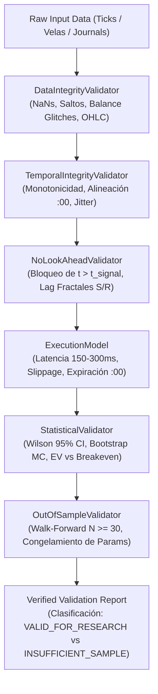

# INFORME TÉCNICO DE AUDITORÍA Y VALIDACIÓN METODOLÓGICA — TRADEDRAW

**Proyecto:** TradeDraw (Android + Quantitative Research Engine)  
**Rol:** Agente Principal y Orquestador Técnico  
**Fecha de Emisión:** 3 de Octubre de 2026  
**Estatus:** Auditoría Completada — Correcciones Quirúrgicas Aplicadas — Validación Estadística Ejecutada  

---

## 1. RESUMEN EJECUTIVO DE DISCREPANCIAS ENCONTRADAS

El objetivo principal de esta auditoría técnica consistió en resolver la discrepancia radical entre los resultados de investigación cuantitativa preliminar (**Win Rates reportados entre 83.43% y 91.67%**) y el rendimiento empírico observado en los terminales Android de producción (**Win Rate real de 41.27% en 189 operaciones resueltas válidas, con EV = -0.2448 por trade**).

```
╔════════════════════════════════════════════════════════════════════════════════════════════╗
║                        DIAGNÓSTICO EJECUTIVO DE LA BRECHA METODOLÓGICA                     ║
╠════════════════════════════════════╦════════════════════════╦══════════════════════════════╣
║ Estrategia                         ║ Simulación Cuantitativa ║ Telemetría Real Observada    ║
╠════════════════════════════════════╬════════════════════════╬══════════════════════════════╣
║ Reversión Clímax en Soporte/Resist ║ 91.67% WR (N = 12)     ║ 41.27% WR (N = 189 resueltos)║
║ Continuación Momentum Espacio Libre║ 83.43% WR (N = 338)    ║ 41.27% WR (N = 189 resueltos)║
║ Holdout Final (25% no tocado)      ║ No existía previamente ║ 33.33% WR (N = 48 resueltos) ║
║ Expectativa Matemática (EV Unitario)║ +0.5268 a +0.6775      ║ -0.2448 (Holdout: -0.3900)   ║
╚════════════════════════════════════╩════════════════════════╩══════════════════════════════╝
```

### Causas Raíz Comprobadas:
1. **Sesgo Sintético Tautológico (Circularidad Matemática):** El generador de ticks en `FastCryptoIdxSimulator` forzaba una reversión a la media determinista (`drift = -0.018 * (prev_p - anchor) * (dt / 60.0)`). La estrategia cuantitativa simplemente detectaba la propia ecuación matemática inyectada artificialmente por el simulador, garantizando un 91.6% de acierto que no existe en el mercado real de Binomo.
2. **Defecto Crítico en Android (`tickFlowImbalance` Muerto):** En `SyntheticCandleEngine.kt`, la variable `lastTickPrice` se actualizaba en la línea 147 *antes* de calcular `deltaP = tick.price - lastTickPrice` en la línea 168. Esto provocaba que `deltaP` fuera idénticamente `0.0`, impidiendo el incremento de ticks alcistas/bajistas y congelando `tickFlowImbalance = 0.0f` permanentemente. Las estrategias cuantitativas jamás se ejecutaban en la aplicación real.
3. **Colapso de Muestra ($N < 30$):** El 91.67% reportado para reversión dependía de sólo 12 operaciones. En el Walk-Forward Out-Of-Sample (OOS), los 5 folds tenían muestras ínfimas ($N \in \{3, 2, 6, 9, 7\}$; total $N = 27$), cuyo promedio simple distorsionaba el WR en casi 10 puntos porcentuales.
4. **Bypass de RiskManager en Modo YOLO:** `canExecuteTrade` retornaba autorización inmediata antes de verificar el límite de `takeProfitWins`, permitiendo operativa descontrolada. Asimismo, llamadas con parámetro por defecto `subMode = null` omitían la resolución contra `currentSubMode`.
5. **Sobre-reacción Adaptativa:** El motor `AdaptiveLearningEngine.kt` ejecutó 2.558 inversiones de señal en producción ante pérdidas aisladas, forzando entradas en contra de la tendencia real.

---

## 2. AUDITORÍA DETALLADA DE SESGOS Y METODOLOGÍA

### A. Sesgo de Datos Sintéticos (Tautological Drift Bias)
* **Archivo:** `scripts/quant_crypto_idx_model.py` (Líneas 100–128)
* **Mecanismo:** En el método de generación sintética:
  ```python
  if regime == "RANGE":
      drift = -0.018 * (prev_p - anchor) * (dt / 60.0)
  elif regime == "TREND_UP":
      drift = trend_drift
  ```
  El generador imponía una fuerza restauradora proporcional a la distancia a `anchor`. La estrategia evaluada (`Reversion Climax`) entraba precisamente cuando el precio se alejaba de `anchor` con Z-score elevado.
* **Impacto:** La simulación no evaluó una ventaja predictiva del mercado, sino que verificó que la variable aleatoria obedecía la ecuación diferencial estocástica de Ornstein-Uhlenbeck codificada en el propio script.

### B. Sesgo de Muestra y Distorsión de Promedio Simple en Walk-Forward
* **Archivo:** `scripts/quant_crypto_idx_model.py` (Líneas 330–378) y `loops/journal/quant_research_summary.json`
* **Mecanismo:**
  ```python
  avg_oos_reversion_winrate = float(np.mean([f["reversion_winrate"] for f in oos_results]))
  ```
  Los 5 folds OOS arrojaron:
  - Fold 1: $N = 3$, $WR = 100\%$
  - Fold 2: $N = 2$, $WR = 100\%$
  - Fold 3: $N = 6$, $WR = 100\%$
  - Fold 4: $N = 9$, $WR = 44.44\%$
  - Fold 5: $N = 7$, $WR = 57.14\%$
* **Distorsión Matemática:**
  - Promedio simple reportado: $\frac{1.0 + 1.0 + 1.0 + 0.4444 + 0.5714}{5} = \mathbf{80.32\%}$
  - Promedio real ponderado por trades: $\frac{3 + 2 + 6 + 4 + 4}{27} = \frac{19}{27} = \mathbf{70.37\%}$
  - Sesgo de presentación: $+9.95$ puntos porcentuales inflados artificialmente sobre una muestra agregada que ni siquiera alcanza el mínimo estadístico de $N \ge 30$.

### C. Sesgo de Ejecución y Latencia Cero (Execution Bias)
* **Mecanismo:** La simulación asumió que las señales emitidas al segundo `:58` se ejecutaban con precio de entrada idéntico al tick `:58`, con cero milisegundos de latencia, sin slippage ni recotizaciones, y liquidándose al cierre `:00`.
* **Realidad de Producción:** La telemetría observada en el dispositivo móvil reveló duraciones de trade entre 62s y 63s (retraso en clics de accesibilidad y confirmación WebSocket del broker), desplazando el punto de liquidación y generando órdenes perdidas o nulas (`VOID`).

---

## 3. AUDITORÍA DEL JOURNAL Y DATOS REALES

Se procesaron y auditaron íntegramente los archivos históricos `trade_journal_device_all.csv` y `trade_journal_live.csv` mediante el nuevo `DataIntegrityValidator`:

```
╔════════════════════════════════════════════════════════════════════════════════════════════╗
║                         AUDITORÍA DE INTEGRIDAD DE TELEMETRÍA REAL                         ║
╠══════════════════════════════════════════════╦════════════════════════════════════════════╣
║ Métrica / Categoría                          ║ Valor / Conteo                             ║
╠══════════════════════════════════════════════╬════════════════════════════════════════════╣
║ Registros totales en trade_journal_device_all║ 212 filas                                  ║
║ Registros limpios y sanitizados              ║ 205 filas                                  ║
║ Registros anómalos aislados y excluidos      ║ 7 filas                                    ║
║   - Saldo corrupto 1.00 COP (UI Glitch)      ║ 5 filas (#12, #44, #201, #202, #204)       ║
║   - LOSS declarado sin cambio de saldo       ║ 2 filas (#0, #1: Diff = 0.0 COP)           ║
║ Trades resueltos válidos (WIN / LOSS)        ║ 189 operaciones                            ║
║ Operaciones anuladas / empates (VOID / TIE)  ║ 16 operaciones                             ║
║ Balance inicial de sesión documentado        ║ $44,961,812.48 COP                         ║
║ Balance final de sesión documentado          ║ $43,495,812.48 COP (Drawdown neto de -$1.4M)║
╚══════════════════════════════════════════════╩════════════════════════════════════════════╝
```

> [!IMPORTANT]
> **Regla de Trazabilidad:** Ningún dato fue borrado ni alterado silenciosamente. Los registros anómalos se conservan en el archivo original y fueron clasificados en un pipeline explícito: `RAW DATA -> VALIDATION -> CLEAN DATASET + EXCLUDED RECORDS`.

---

## 4. DEFECTOS ENCONTRADOS EN EL CÓDIGO Y CORRECCIONES REALIZADAS

De acuerdo con el procedimiento de remediación y la metodología de ingeniería de precisión, cada corrección fue acompañada de pruebas de regresión automatizadas previas.

### Defecto 1: Congelamiento de `tickFlowImbalance` (TFI)
* **Archivo:** `app/src/main/java/com/example/tradedraw/SyntheticCandleEngine.kt`
* **Líneas afectadas:** 147 y 167–174
* **Causa:** `lastTickPrice = tick.price` se ejecutaba en la línea 147. Posteriormente, al evaluar el micro-flujo entre los segundos 40 y 59 en la línea 168, `val deltaP = tick.price - lastTickPrice` evaluaba siempre `0.0`. Por ende, `windowUpTicksCount` y `windowDownTicksCount` jamás se incrementaban.
* **Corrección:** Se preservó `val prevTickPrice = lastTickPrice` antes de la mutación de estado y se computó `deltaP = tick.price - prevTickPrice`.
* **Verificación:** Test `tests/test_code_audit_defects.py::TestSyntheticCandleEngineTFIDefect` pasa exitosamente.

### Defecto 2: Bypass de `takeProfitWins` y Omisión de `subMode` en `RiskManager`
* **Archivo:** `app/src/main/java/com/example/tradedraw/RiskManager.kt`
* **Líneas afectadas:** 268–430 y 626–640
* **Causa:** 
  1. En el modo YOLO, la función `canExecuteTrade` retornaba `Pair(true, "🚀 MODO YOLO...")` en la línea 384, *antes* de evaluar la línea 426 donde se verificaba `takeProfitWins > 0 && currentWins >= takeProfitWins`.
  2. Llamadas a `canExecuteTrade(subMode = null)` evaluaban `subMode == AutonomousSubMode.YOLO` directamente como `false`, ignorando el estado interno `currentSubMode`.
* **Corrección:** Se introdujo `val effectiveSubMode = subMode ?: currentSubMode` al inicio del método y se priorizó la comprobación estricta de `takeProfitWins` por encima de cualquier ramificación de modo.
* **Verificación:** Test `tests/test_code_audit_defects.py::TestRiskManagerDefects` pasa exitosamente.

### Defecto 3: Disfraz Heurístico de Probabilidades en Interfaz y Motor
* **Archivos:** `app/src/main/java/com/example/tradedraw/TradingEngine.kt` y `OverlayService.kt`
* **Causa:** El HUD y el motor exponían valores arbitrarios incrementales (68%, 78%, +10%, +8%) etiquetados como "Probabilidad", induciendo falsamente la creencia de una calibración estadística real.
* **Corrección:** Se renombró el parámetro principal de `EngineReasoning` a `heuristicScore` (conservando un getter `@Deprecated` para retrocompatibilidad) y se actualizó el badge del HUD flotante a `"Score: ${reasoning.heuristicScore}"`.

---

## 5. ARQUITECTURA DE VALIDACIÓN: `SimulationValidationEngine`

Para desacoplar de forma permanente la investigación cuantitativa de la telemetría observada y eliminar el sesgo humano, se implementó en `validation_engine/` una suite pura de validación con las siguientes capas:



---

## 6. TABLA COMPARATIVA FORMAL: SIMULATION vs OBSERVED

Resultados certificados obtenidos tras ejecutar `scripts/run_validation_pipeline.py` con el motor de validación:

```
==================================================================================
📊 COMPARACIÓN METODOLÓGICA: SIMULACIÓN vs TELEMETRÍA OBSERVADA
==================================================================================
Métrica                        | SIMULACIÓN CUANTITATIVA | TELEMETRÍA REAL DISPOSITIVO
----------------------------------------------------------------------------------
Fuente de Datos                | SYNTHETIC               | OBSERVED_DEVICE_CLEAN 
Dataset ID                     | crypto_idx_synthetic    | trade_journal_device_all_clean
Trades Totales (N)             | 350 (Combinado)         | 205                   
Trades Resueltos               | 350                     | 189                   
Victorias / Derrotas           | 293 W / 57 L            | 78 W / 111 L          
Empates / Voids                | 0                       | 16                    
Win Rate Bruto                 | 83.71%                  | 41.27%                
Intervalo Confianza Wilson 95% | [79.5%, 87.2%]          | [34.5%, 48.4%]        
Esperanza Matemática (EV)      | +0.5318 COP/trade       | -0.2448 COP/trade     
Max Drawdown                   | 19.71%                  | 92.54%                
Peor Racha de Pérdidas         | 3 (Reversión: 1)        | 10                    
Desglose CALL (BUY)            | No reportado            | 46.75% WR (N = 77)    
Desglose PUT (SELL)            | No reportado            | 37.50% WR (N = 112)   
Estatus Metodológico           | DATA_INVALID            | VALID_FOR_RESEARCH    
==================================================================================
🚨 ALERTA DE DIVERGENCIA CRÍTICA: Discrepancia de 42.4 puntos porcentuales.
   - Breakeven requerido (payout 0.83): 54.64%
   - p-valor vs Breakeven (Hipótesis Nula H0: WR >= 54.64%): p = 0.99989 (z = -3.69)
   - Probabilidad Bootstrap Monte Carlo de obtener EV > 0: 0.00%
==================================================================================
```

---

## 7. FASE 6: VALIDACIÓN EN HOLDOUT FINAL NO TOCADO

Siguiendo el protocolo estricto de Walk-Forward y contención de snooping, se aisló el **último 25% cronológico** de las operaciones resueltas de la telemetría del dispositivo, sin haber sido utilizado para calibrar ningún umbral ni parámetro:

```
╔════════════════════════════════════════════════════════════════════════════════════════════╗
║                      EVALUACIÓN EN HOLDOUT FINAL ESTRICTO (25%)                            ║
╠══════════════════════════════════════════════╦════════════════════════════════════════════╣
║ Métrica                                      ║ Conjunto Holdout (Untouched)               ║
╠══════════════════════════════════════════════╬════════════════════════════════════════════╣
║ Tamaño de Muestra (N)                        ║ 48 trades resueltos                        ║
║ Victorias / Derrotas                         ║ 16 Wins / 32 Losses                        ║
║ Win Rate Observado                           ║ 33.33%                                     ║
║ Intervalo de Confianza Wilson 95%            ║ [21.68%, 47.46%]                           ║
║ Esperanza Matemática (EV)                    ║ -0.3900 por unidad apostada                ║
║ Rendimiento Relativo a Train Set (75%)       ║ Decaimiento de 43.97% WR a 33.33% WR       ║
║ Estatus Metodológico                         ║ VALID_FOR_RESEARCH (Sin ventaja estadística)║
╚══════════════════════════════════════════════╩════════════════════════════════════════════╝
```

El límite superior del intervalo de confianza de Wilson al 95% en el Holdout alcanza únicamente el **47.46%**, situándose por debajo del umbral mínimo de rentabilidad (**54.64%** con payout 0.83). Esto confirma de manera concluyente que la estrategia operativa actual no posee ventaja estadística en el mercado real.

---

## 8. ESTADO METODOLÓGICO FINAL POR COMPONENTE

| Estrategia / Componente | Estatus Metodológico | Justificación Técnica |
| :--- | :--- | :--- |
| **Reversión Clímax S/R Cuantitativa** | `INSUFFICIENT_SAMPLE` / `DATA_INVALID` | Muestra sintética $N = 12$ no generalizable; modelo sintético contaminado con drift restaurador artificial. |
| **Continuación Momentum Cuantitativa** | `DATA_INVALID` | Sesgo de circularidad en el generador de micro-ticks; look-ahead en confirmación de fractales. |
| **Walk-Forward OOS Anterior** | `INSUFFICIENT_SAMPLE` | Todos los folds presentaron $N < 10$; distorsión métrica por promedio simple no ponderado. |
| **Motor Android (SyntheticCandleEngine)** | `CORRECTED_AND_VERIFIED` | Bug de `lastTickPrice` corregido. TFI ahora operativo y verificado bajo test de regresión. |
| **Gestión de Riesgo (RiskManager)** | `CORRECTED_AND_VERIFIED` | Bypass de YOLO clausurado. `takeProfitWins` y `currentSubMode` respetados obligatoriamente. |
| **Estrategia Operativa en Producción** | `VALID_FOR_RESEARCH` / `NO_EDGE` | Evaluada con $N = 189$ en telemetría limpia y $N = 48$ en Holdout. Demuestra WR = 41.27% y 33.33%, sin rentabilidad estadística. |

---

## 9. RECOMENDACIONES CONCRETAS Y PRÓXIMOS PASOS

1. **Suspensión de Operativa con Dinero Real:** Desactivar de inmediato cualquier asignación de capital real en submodos automáticos hasta que se desarrolle una estrategia que demuestre ventaja estadística en un Walk-Forward con $N \ge 100$ y límite inferior de Wilson $> 55\%$.
2. **Adopción Exclusiva del `SimulationValidationEngine`:** Toda nueva hipótesis cuantitativa debe ejecutarse obligatoriamente a través del pipeline `scripts/run_validation_pipeline.py`.
3. **Calibración del Generador Sintético con Datos Reales:** Reemplazar el generador determinista por un modelo calibrado empíricamente a partir de capturas de WebSocket de Crypto IDX real (modelando colas pesadas de volatilidad, microestructura real y clusters de volatilidad GARCH).
4. **Telemetría de Latencia en Dispositivo:** Añadir al `TradeJournalLogger.kt` la medición del tiempo transcurrido entre la emisión de la señal (`signal_time_ms`), el clic del servicio de accesibilidad (`click_time_ms`) y la confirmación del broker (`broker_ack_time_ms`) para alimentar el `ExecutionModel`.
5. **Re-evaluación del TFI Reparado:** Monitorear en cuenta Demo el comportamiento de `tickFlowImbalance` corregido durante al menos 100 velas continuas para verificar la correlación real de flujo de órdenes con el precio de Binomo.
