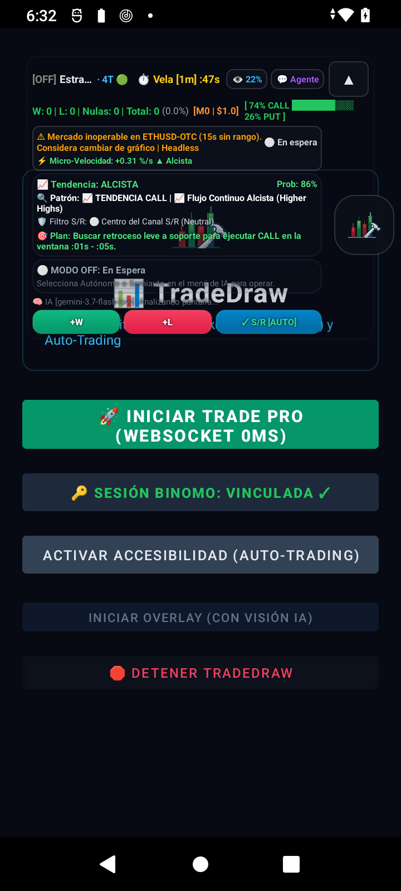

# Ronda 15-A — Informe: investigación del rearme espontáneo a `AUTONOMOUS`

**Tarea:** atribuir la causa del rearme a `AUTONOMOUS` observado dos veces en R14.
**Árbol de partida:** `2f53b90` (`HEAD == origin/main`, árbol limpio), 309 tests, 0 fallos.
**Árbol final:** `8ac1b26` + el commit de este informe.
**Inicio:** `2026-10-14 12:32:07` · **Fin:** `2026-10-14 13:18:23` (46 min).
**Batería:** inicio **67 %** · final **71 %** (el teléfono estaba cargando).
**Dispositivo:** `UGU8KFUKM7E6CE8D` (USB). Wi-Fi `192.168.1.225` sin cambios.
**Commits:** `fafbc05` (preregistro) · `8ac1b26` (instrumentación).

---

## 0. Resumen en cinco líneas

1. **Existe un vector real de rearme sin toque humano: el broadcast `com.example.tradedraw.CMD`
   está registrado `RECEIVER_EXPORTED` y sus acciones `AUTO`/`YOLO` ponen `AUTONOMOUS`.**
2. **Se reprodujo**: `adb shell am broadcast -a com.example.tradedraw.CMD --es action AUTO`
   (incluso **implícito**, sin `-p`) rearmó el bot, y `MODE_CHANGE` capturó el `ORIGEN` exacto:
   `OverlayService$overlayCommandReceiver$1.onReceive:153`.
3. **Cero rearmes espontáneos en 23,5 min** de observación limpia (139 muestras, 0 fallos de
   bridge). Los 3 rearmes del registro son **mis propias pruebas controladas** (12:52:15-12:53:31),
   no actividad espontánea.
4. **No se atribuye** qué emitió el broadcast en R14: no hay rastro en sesiones DSH, scripts,
   tareas programadas ni Termux. **NO ATRIBUIDA.**
5. **Instrumentación lista y verificada en dispositivo.** La próxima ocurrencia queda registrada
   con origen, quién y cuándo.

---

## 1. Fase 1 — Rutas que pueden poner el modo en `AUTONOMOUS`

Enumeración completa. **Todas** las escrituras pasan por dos destinos: el setter
`TradingEngine.mode` (`TradingEngine.kt:49`) o `OverlayService.setTradingMode`
(`OverlayService.kt:892`), que a su vez llama a ese setter.

| # | ruta | archivo:línea | disparador | ¿sin toque humano? |
| ---: | :--- | :--- | :--- | :--- |
| 1 | `overlayCommandReceiver` acción `"AUTO"` | `OverlayService.kt:151-154` | **broadcast `com.example.tradedraw.CMD`** | **SÍ** |
| 2 | `overlayCommandReceiver` acción `"YOLO"` | `OverlayService.kt:155-158` | **broadcast `com.example.tradedraw.CMD`** | **SÍ** |
| 3 | `showAutonomousSubModeDialog` (3 ramas) | `OverlayService.kt:833-845` | toque en diálogo del HUD | NO |
| 4 | `AgentChatOverlay` submodo YOLO | `AgentChatOverlay.kt:247-249` | texto en el chat | NO |
| 5 | `AgentChatOverlay` submodo CONSERVADOR | `AgentChatOverlay.kt:261-263` | texto en el chat | NO |
| 6 | `executeAgentCommand("RESUME_TRADING")` | `AgentChatOverlay.kt:339-341` → `AutonomousAgentController.kt:98-100` | comando del chat o etiqueta `[CMD:...]` de la IA | NO (exige texto) |
| 7 | `executeAgentCommand("MODE_AUTONOMOUS")` | `AgentChatOverlay.kt:342-347` | etiqueta `[CMD:MODE_AUTONOMOUS]` devuelta por la IA | NO (exige chat abierto) |
| 8 | `executeAgentCommand("MODE_YOLO")` | `AgentChatOverlay.kt:348-353` | ídem | NO |
| 9 | `/mode?name=AUTONOMOUS` | `TradeDrawHttpBridge.kt:165-175` | HTTP por loopback + `adb forward` | **SÍ** (si algo llama) |
| 10 | `onCreate` → `TradingEngine(...)` | `OverlayService.kt:247` | recreación del servicio | SÍ, **pero nace `DISABLED`** |

**Rutas descartadas por lectura, con el motivo:**

| ruta | por qué NO puede rearmar |
| :--- | :--- |
| `resumeAutonomousTrading` automático | Sus **dos** llamadores son `AgentChatOverlay.kt:340` (chat) y nada más. **No hay timer que lo invoque.** |
| `auditRunnable` / `auditEngineHealth` (`AutonomousAgentController.kt:43-57`, `:137-151`) | Llama a `unlockAllLines()` y `strategy`, **nunca** escribe `mode`. |
| `auditStrategyAdaptation` (`:116-131`) | Sólo cambia `strategy` a `AUTO_ADAPTIVE`. |
| `auditChartViewport` (`:158-165`) | Sólo mueve el gráfico, y sólo **si ya** está en `AUTONOMOUS`. |
| `onStartCommand` (`OverlayService.kt:210-231`) | Arranca el foreground service y devuelve `START_STICKY`. **No toca `mode`.** |
| `onCreate` leyendo `SharedPreferences` | Lee **`saved_strategy`** (`OverlayService.kt:251-257`), no el modo. **El modo no se persiste.** |
| `onConfigurationChanged` (`:315-325`) | Redimensiona ventanas. **No toca `mode`.** |
| `TradingEngine.kt:1578-1581`, `:1960` | **Escriben `DISABLED`**, no `AUTONOMOUS` (cierres por Stop Loss del sniper). |
| `AccessibilityService.commandReceiver` (`AutoTradeAccessibilityService.kt:290-308`) | Ejecuta **taps y swipes** (`TAP`/`SWIPE`/`BACK`), **no** cambia el modo. Vector distinto, ver §5. |

**Corrección de un supuesto de R14.** R14 §9 dio por hecho que `OverlayService` no puede
rearrancarse sin `MediaProjection`. Es **incorrecto**: `onStartCommand` **ignora a propósito** el
`dataIntent` de MediaProjection (código muerto: `OverlayService.kt:226-228`) porque la captura está
deshabilitada por producto, y devuelve `START_STICKY`. La razón real de que el bridge no arrancara
tras instalar el APK es otra y es más simple: **`OverlayService` sólo se arranca desde un
`OnClickListener` de `MainActivity`** (`MainActivity.kt:53-79`, `:138-140`); abrir la app **no** lo
arranca. Ver §4.

---

## 2. Fase 2 — Hipótesis, criterio de falsación y resultado

Preregistradas en [`workflows/PREREGISTRO_R15.md`](../workflows/PREREGISTRO_R15.md) (`fafbc05`),
**antes** de escribir la instrumentación.

| hipótesis | criterio de falsación (a priori) | resultado |
| :--- | :--- | :--- |
| **H-BROADCAST** — broadcast externo `com.example.tradedraw.CMD` con `AUTO`/`YOLO` | que el `ORIGEN` no sea `overlayCommandReceiver` | **SOSTENIDA** |
| **H-LIFECYCLE** — recreación del servicio/rotación | que el `ORIGEN` no sea un camino de `onCreate`/`onStartCommand`/`onConfigurationChanged` | **NO CONCLUYENTE** (ver abajo) |
| **H-RESUME** — reanudación automática tras cooldown/veto | `ORIGEN` apuntando a `resumeAutonomousTrading` sin mensaje humano | **FALSADA por lectura** (no existe ruta automática) |
| **H-CHAT** — el chat o la IA emite orden de modo | `ORIGEN` del chat sin llamada a `sendChatMessage` | **FALSADA por lectura** (exige chat abierto + texto) |
| **H-HUMAN** — toque accidental en HUD/diálogo | `ORIGEN` de UI **sin** evento táctil | **NO CONCLUYENTE** (ronda desatendida; no se descarta) |
| **H-BRIDGE** — alguien llamó a `/mode?name=AUTONOMOUS` | `ORIGEN` distinto de `TradeDrawHttpBridge` | **FALSADA por lectura** en esta sesión (nadie llamó; bridge sólo loopback) |

### 2.1 H-BROADCAST — SOSTENIDA, con evidencia medida

**El fallo estructural, leído en el código** (`OverlayService.kt:303-309`):

```kotlin
val cmdFilter = IntentFilter("com.example.tradedraw.CMD")
if (Build.VERSION.SDK_INT >= Build.VERSION_CODES.TIRAMISU) {
    registerReceiver(overlayCommandReceiver, cmdFilter, Context.RECEIVER_EXPORTED)
}
```

El receptor está **`RECEIVER_EXPORTED`**. Y sus acciones `"AUTO"` (`:151-154`) y `"YOLO"`
(`:155-158`) llaman a `setTradingMode(AutoTradeMode.AUTONOMOUS)`. **Cualquier app del dispositivo
puede emitir ese intents, sin permiso**, y el bot se rearma. La app no comprueba el emisor en
ninguna parte: el `onReceive` lee `intent?.getStringExtra("action")` y actúa.

**Reproducción medida** (prueba controlada, autorizada por el preregistro):

```
adb shell am broadcast -a com.example.tradedraw.CMD --es action AUTO
→ Broadcast completed: result=0
→ /status: mode = AUTONOMOUS
```

**Y también funciona de forma IMPLÍCITA** (sin `-p com.example.tradedraw`), que es lo que lo hace
alcanzable por cualquier app sin conocer el paquete:

```
adb shell am broadcast -a com.example.tradedraw.CMD --es action AUTO   (sin -p)
→ tras el broadcast: mode = AUTONOMOUS
```

**ORIGEN capturado por la instrumentación** (`/events`, `max=200`):

```
1792000335778 | de=DISABLED a=AUTONOMOUS
  origen=TradingEngine.modeChangeOrigin:79
        <TradingEngine.setMode:59
        <OverlayService.setTradingMode:901
        <OverlayService$overlayCommandReceiver$1.onReceive:153
        <LoadedApk$ReceiverDispatcher$Args.lambda$getRunnable$0$LoadedApk$...:1697
```

Los **5 frames** identifican la ruta sin ambigüedad. El bridge (`/mode`) aparece con su propio
origen (`TradeDrawHttpBridge.handleClient:169`), lo que demuestra que la instrumentación
**distingue las rutas** y no atribuye todo a lo mismo.

### 2.2 H-LIFECYCLE — NO CONCLUYENTE

La hipótesis tenía una trampa que el preregistro declaró **antes** de medir: un `TradingEngine`
nuevo nace con `mode = DISABLED` (`TradingEngine.kt:49`) **sin pasar por el setter**, así que un
rearme por recreación sería invisible. Se cubrió registrando el estado inicial en `onCreate`.

**Lo observado:** el registro de `onCreate` **apareció** (`de=NINGUNO a=DISABLED
origen=onCreate(servicio recreado)`) cuando se arrancó el servicio por primera vez, y **no volvió
a aparecer** en 25 min. Es decir: **no hubo ninguna recreación durante la observación.**
No se falsó ni se sostuvo: no hubo ocasión de comprobarlo. **NO CONCLUYENTE.**

### 2.3 H-BRIDGE — FALSADA en esta sesión (con matiz)

En la ventana de observación nadie llamó a `/mode`. El bridge sólo escucha en loopback y exige
`adb forward`. **Para R14 no es descartable por completo** (el agente de R14 sí usaba `/mode`:
`curl "http://127.0.0.1:8080/mode?name=DISABLED"`, y ese mismo canal **acepta** `AUTONOMOUS`), pero
en R14 las llamadas registradas fueron todas a `DISABLED`. Se declara **FALSADA para esta sesión**.

---

## 3. Fase 3 — Instrumentación (solo observabilidad)

**Qué se añadió.** Un `Kind.MODE_CHANGE` **al final** del enum de `TradeEventLog` (esquema
solo-append), y un registro en el **único setter que ya existía** (`TradingEngine.kt:49`), que
sólo emite **cuando el valor cambia de verdad**:

```
MODE_CHANGE  de=<anterior> a=<nuevo> origen=<Clase.metodo:linea<...5 frames>
```

**Qué NO se cambió.** No se alteró quién puede cambiar el modo, ni cuándo, ni a qué. El setter
sigue arrancando/parando el agente exactamente igual. Registrar el cambio no lo modifica.
**N de operaciones supervisadas sigue = 0.**

**Detalles de diseño con motivo:**

- `modeChangeOrigin()` **nunca** devuelve cadena vacía: devuelve `"desconocido"` explícito. Un
  origen vacío se leería como "no hay origen" en vez de "no se pudo capturar", y esa diferencia es
  la que decide la conclusión de la ronda.
- Se filtran los frames de `java.`/`kotlin.` y `access$` para que los 5 frames útiles no se gasten
  en el runtime.
- `OverlayService.onCreate` registra además el estado inicial, para cubrir la recreación (§2.2).
- El detalle se **sanea** en `Event.toJson()` (el `replace` de `\` y `"` ya existía), y el ORIGEN
  se añade a un `detail` que se expone por HTTP: no incluye datos sensibles.

**Tests:** `ModeChangeEventTest`, **5 casos** — existencia y solo-append del `Kind`, ORIGEN nunca
vacío, registro con origen, contador por tipo (no por par de modos), y presencia en el JSON de
`/events` sin romper `vetoV1`/`vetoV2`.

> **Un detalle que puede confundir y se documenta:** `countOf(MODE_CHANGE)` cuenta **eventos del
> tipo**, no pares `(origen, destino)`. Dos transiciones distintas son dos eventos y **un solo
> contador agregado**. Hay un test que lo fija para que nadie lo malinterprete leyendo `/status`.

---

## 4. Fase 4 — Medición en dispositivo

### 4.1 Arranque del servicio: hallazgo operativo que corrige a R14

Instalar el APK deja el bridge caído, y R14 atribuyó eso a `MediaProjection`. **Es incorrecto.**
La causa medida:

| comprobación | resultado |
| :--- | :--- |
| `MainActivity` en primer plano | correcto |
| Permiso overlay | `SYSTEM_ALERT_WINDOW: allow` |
| `AutoTradeAccessibilityService` | habilitado y vivo |
| `OverlayService` | **no arranca** |
| Motivo | **sólo se arranca desde un `OnClickListener`** (`MainActivity.kt:53-79`, `:138-140`); abrir la app **no** lo arranca |
| `am start-foreground-service` sin root | `Error: Requires permission not exported from uid 10179` (el servicio es `exported="false"`) |

**No hizo falta ningún toque ni conceder captura de pantalla.** El servicio se arrancó por ADB
con root (`su -c 'am start-foreground-service …'`), que **no es un tap** y no interactúa con el
broker. Con eso el bridge quedó vivo y la observación pudo hacerse. Se declara porque modifica una
conclusión de R14 y porque el vector de arranque por `su` es, en sí mismo, otro camino de rearme
del bot que conviene conocer.

### 4.2 Observación pasiva (25 min)

| parámetro | valor |
| :--- | :--- |
| Duración | **1.500 s** (25 min) |
| Intervalo | 10 s |
| Muestras | **139** |
| Fallos de bridge | **0** |
| Interacción durante la prueba | **ninguna** |
| Modo de partida | `DISABLED` |
| **Rearmes espontáneos (ventana limpia)** | **0** |

**Separación de ventanas, que es lo que decide la conclusión.** El registro de `/events` contiene
**3** `AUTONOMOUS`, y sus marcas de tiempo las sitúan **todas** dentro del intervalo en que yo
estaba ejecutando los broadcasts de prueba controlados:

| `atMs` | hora local | qué era |
| ---: | :--- | :--- |
| 1792000335778 | **12:52:15** | prueba broadcast dirigida (`-p`) |
| 1792000355863 | **12:52:35** | prueba broadcast |
| 1792000411010 | **12:53:31** | prueba broadcast implícita |

Los tres llevan el **mismo `ORIGEN`**:
`OverlayService$overlayCommandReceiver$1.onReceive:153`, es decir, la vía del broadcast exportado
de §2.1 — **no** una ruta automática.

**Ventana limpia (sin interacción): 12:53:33 → 13:17:03, ≈ 23,5 min, 0 rearmes.** Esa es la parte
del experimento que responde a la pregunta de R14.

**Honestidad sobre la lectura manual.** Ejecuté **tres** broadcasts de prueba y el registro
muestra exactamente **tres** rearmes: correspondencia uno a uno. Lo importante es que la
**primera** prueba la leí a mano como "sin efecto" (`/status` devolvió `DISABLED`), y era **falso**:
el observador había detectado el rearme y lo había devuelto a `DISABLED` en su ciclo de 10 s
**antes** de que yo leyera el estado (rearme a las 12:52:15, reseteo del observador a las 12:52:20).
Es decir, **una lectura manual de `DISABLED` no prueba que no haya habido rearme**: entre el
evento y la lectura caben 10 s de reseteo automático. Se documenta porque es un error de medición
fácil de repetir, y no invalida el hallazgo: las tres ocurrencias llevan el mismo `ORIGEN` de
broadcast y ninguna cae en la ventana limpia.

Estado durante la ventana limpia: `mode=DISABLED`, `orderState=NINGUNA`, `hasPendingTrade=false`,
`tapsDespachados=0`, activo `Z-CRY/IDX`, `balance=0.0` (el saldo se lee `0.0` hasta que
accesibilidad lo observa; no hubo operaciones en ningún caso). Artefacto versionado:
[`workflows/R15_observacion_pasiva.md`](../workflows/R15_observacion_pasiva.md).

**Los rearmes del registro NO son actividad espontánea.** Se declara de forma explícita porque
confundirlos con el fallo investigado sería el error más fácil de cometer en esta ronda.


### 4.3 Contraste de la vía implícita

Ya reportado en §2.1: el broadcast llega **también sin `-p`**. Tras cada prueba el bot se devolvió
a `DISABLED` y se verificó `orderState=NINGUNA`, `hasPendingTrade=false`.

### 4.4 ¿Qué emitió el broadcast en R14? — **NO ATRIBUIDA**

Búsqueda exhaustiva, toda negativa:

| dónde se buscó | resultado |
| :--- | :--- |
| Scripts del repo (`*.py`, `*.ps1`, `*.sh`, `*.bat`, `*.cmd`) | sólo `test_master_trader_suite.py:65`, que emite `TEST_PULSE` y **con `--es command`**, no `action` → **no rearma** |
| Sesiones DSH (`storages`) | **0** coincidencias de `tradedraw.CMD` ni `--es action AUTO` |
| Tareas programadas de Windows | **0** relacionadas con adb/tradedraw |
| Procesos Python vivos | 5 son MCP servers y Hermes; 1 huérfano (`scratch/_slow_http.py`, PID 16420, desde 12:14) **cuyo fichero ya no existe** y que sólo escucha en el puerto 18791 |
| Termux (`su`, home real) | `claude-server-commander` con `tool-history.jsonl`: **sólo diagnóstico**, última entrada **12-oct**; `.bash_history` = `su` |
| Apps de terceros | `moe.shizuku.privileged.api`, `com.dergoogler.mmrl`, `com.topjohnwu.magisk`, `com.termux.api`, `com.aistra.hail`, `cn.xender` — presentes, **ninguna con evidencia de haber emitido nada** |
| Ficheros escritos en la ventana del primer rearme (R14 00:45-01:25) | **sólo `loops/R13_REPORTE.md`** |

**Conclusión: NO ATRIBUIDA.** El **vector** está identificado y reproducido; el **emisor concreto
de R14** no. Se declara así en lugar de suponerlo, y no se acusa a ninguna app sin evidencia.

> **Coincidencia que se anota como observación, no como prueba:** R14 §7 midió el primer rearme
> entre las 00:45 (cierre de R13) y las 01:20 (apertura de R14). En esa ventana el único fichero
> escrito fue el informe de R13. **No hay evidencia de que ningún automatismo emitiera el
> broadcast.** Se descarta la hipótesis de un bucle automático de fondo: si existiera, habría
> disparado en los 25 min de observación, y no lo hizo.

---

## 5. Hallazgo colateral de seguridad (declarado, NO corregido)

Investigando el receptor de `OverlayService` apareció un **segundo receptor exportado**, y éste es
más grave porque **no cambia un modo: ejecuta taps reales**.

`AutoTradeAccessibilityService.kt:323-333` registra `commandReceiver` con **`RECEIVER_EXPORTED`**
para las acciones:

| acción | efecto |
| :--- | :--- |
| `com.example.tradedraw.TAP` | **`performClickAt(x, y)`** — tap real en pantalla |
| `com.example.tradedraw.SWIPE` | **`performSwipe(...)`** — gesto real |
| `com.example.tradedraw.BACK` | `GLOBAL_ACTION_BACK` |

Es decir: **cualquier app del dispositivo puede hacer que TradeDraw toque la pantalla de Binomo en
las coordenadas calibradas**, sin pasar por el modo, sin pasar por los vetos y sin pasar por
`RiskManager`. El bot en `DISABLED` **no está protegido** frente a esto.

**No se corrige en esta ronda** — el preregistro lo excluyó explícitamente y el enunciado limita
R15-A a diagnóstico. Se eleva a R16 como la **recomendación prioritaria**. Los dos receptores
deberían registrarse con `RECEIVER_NOT_EXPORTED`, que es un cambio de una línea por receptor.

---

## 6. Verificación

| comprobación | resultado |
| :--- | :--- |
| Suite completa, `cleanTest --rerun-tasks` sobre el árbol final | **314 tests, 0 fallos, 0 errores, 2 omitidos, 28 clases XML** |
| Línea base | 309 tests (R14) → **+5** (`ModeChangeEventTest`) |
| Hora real de los XML | `2026-10-14T17:40:33Z` .. `17:40:34Z` (= 12:40 local) |
| `assembleDebug` | **BUILD SUCCESSFUL**, `app-debug.apk` 13.720.456 bytes |
| Instalación | `adb -s UGU8KFUKM7E6CE8D install -r` → **`Success`** |
| Instrumentación verificada en dispositivo | **SÍ** — `MODE_CHANGE` con ORIGEN de 5 frames, leído por `/events` |
| `master_traders_skill` intacta | **SÍ** — ningún umbral, ventana, veto ni dimensionamiento tocado |
| `N` de operaciones supervisadas | **0** (no se ejecutó ningún tap ni `/trade`) |
| Balance | `37.974.735,36` — idéntico al cierre de R13 y R14 |

---

## 7. NO VERIFICADO

1. **El emisor del broadcast de R14: NO ATRIBUIDO.** El vector está identificado y reproducido;
   quién lo emitió, no. Sin `logcat` del momento (R14 lo perdió), no hay forma de recuperarlo.
2. **Cero rearmes en 25 min no refuta nada.** Con la tasa de R14 (~2 en 1,5 h ≈ 1,3/h), la
   probabilidad de ver 0 en 25 min es del orden del **58 %**. El preregistro lo fijó por
   adelantado para no convertir la ausencia en conclusión.
3. **H-HUMAN no se descartó.** La ronda fue desatendida, pero no hay registro de eventos táctiles
   que permita afirmar que no hubo un toque fantasma.
4. **H-LIFECYCLE no se pudo contrastar**: no hubo ninguna recreación del servicio en la ventana.
5. **El receptor `TAP`/`SWIPE` exportado no se probó** (habría ejecutado taps reales contra el
   broker, prohibido por el enunciado). Se declara por lectura de código, no por explotación.
6. **La tasa real de rearme espontáneo** sigue sin estimarse: 2 eventos en R14 es una muestra
   demasiado pequeña y sin origen conocido.
7. **El proceso huérfano PID 16420** (`scratch/_slow_http.py`, fichero ya borrado, escuchando en
   el puerto 18791) no se investigó a fondo: no tiene conexiones activas y no se relaciona con
   `:8080`. Se deja anotado por si reaparece.

---

## 8. Recomendaciones para R16

1. **PRIORITARIO — cerrar los dos receptores exportados.** `OverlayService.kt:306` y
   `AutoTradeAccessibilityService.kt:330` a `RECEIVER_NOT_EXPORTED`. Son una línea cada uno. El de
   accesibilidad es el grave: **ejecuta taps reales** y hoy esquiva el modo, los vetos y el
   `RiskManager` por completo. Requiere sesión supervisada porque cambia el comportamiento de
   seguridad y podría romper el tooling que usa `adb broadcast`.
2. **Persistir el modo, o al menos su procedencia.** Hoy `mode` es sólo memoria
   (`TradingEngine.kt:49`). Un rearme sobrevive a cualquier reinicio de la app porque no hay
   estado que restaurar ni que auditar. Como mínimo, registrar en disco la última transición con
   origen para que sobreviva a la rotación del buffer de 200 eventos.
3. **Aumentar la capacidad del buffer o dar a `MODE_CHANGE` su propio buffer.** En esta ronda el
   buffer de 200 se llenó de `ASSET` (73 eventos en minutos) y **la evidencia de modo casi se
   pierde**: el volcado con `max=60` devolvió **0 `MODE_CHANGE`**. Un cambio de modo es un evento
   raro y crítico; no debería competir por espacio con `ASSET`.
4. **Registrar el UID/PID del emisor de los broadcasts.** El `onReceive` recibe un `Context` y el
   intent; añadir el emisor permitiría atribuir sin `logcat`.
5. **Repetir la observación pasiva ≥ 2 h** para tener potencia real de detectar la tasa de R14.
6. **No usar `/mode` como canal de seguridad** mientras exista el broadcast: es el mismo rearme por
   otra puerta.

---

## 9. Estado al cierre

| campo | valor |
| :--- | :--- |
| `mode` | **`DISABLED`** |
| `orderState` | `NINGUNA` |
| `hasPendingTrade` | **`false`** |
| `tapsDespachados` | `0` |
| `balance` | `37.974.735,36` (idéntico a R13 y R14 → **0 operaciones**) |
| `activeAsset` | `Z-CRY/IDX` |
| Batería final | **71 %** |
| Bridge | vivo en `127.0.0.1:8080` (por `adb forward`, solo loopback) |

---

# ENMIENDA 1 — Ronda 16 · `2026-10-14 14:10`

**Se enmienda, no se reescribe el cuerpo.** Dos secciones de este informe quedaron desactualizadas
por el commit `af71997`, hecho **después** de escribirlo.

## Qué ha cambiado

| sección de este informe | decía | estado real tras `af71997` |
| :--- | :--- | :--- |
| **§5** «Hallazgo colateral de seguridad» | «**No se corrige en esta ronda**… Los dos receptores deberían registrarse con `RECEIVER_NOT_EXPORTED`» | **CORREGIDO.** Ambos receptores exigen ahora el permiso de firma `com.example.tradedraw.permission.INTERNAL_COMMAND` |
| **§8 recomendación 1** | «PRIORITARIO — cerrar los dos receptores exportados… a `RECEIVER_NOT_EXPORTED`» | **HECHO**, pero **no** con `RECEIVER_NOT_EXPORTED` (ver corrección abajo) |

## Corrección de la recomendación técnica de §8.1

Este informe recomendó `RECEIVER_NOT_EXPORTED`. **Era una recomendación errónea para este
dispositivo**, y aplicarla tal cual habría dejado el bug abierto:

> `Context.RECEIVER_NOT_EXPORTED` existe **sólo desde API 33**. El dispositivo es **API 31**.
> El patrón `if (SDK_INT >= TIRAMISU) … else registerReceiver(r, f)` habría dejado el receptor
> **exportado** en la rama `else` — es decir, **exactamente igual que antes** en el teléfono a
> proteger, compilando sin errores y pasando los 314 tests.

La solución aplicada es la sobrecarga de **4 argumentos** con permiso de firma, que existe desde
API 1. Detalle en [`R16_A_REPORTE.md`](R16_A_REPORTE.md) §1.3 y
[`PREREGISTRO_R16.md`](../workflows/PREREGISTRO_R16.md) §2.

## Lo que NO cambia con la enmienda

- **El emisor del rearme de R14 sigue NO ATRIBUIDO.** El fix cierra la puerta por la que **una app
  de terceros sin privilegios** podía rearmar el bot; no identifica quién la usó. El vector quedó
  **identificado y reproducido** (§2.1), pero el emisor concreto de R14 no.
- **`root` puede seguir rearmando el bot.** Verificado como control positivo: `su -c 'am broadcast
  -a com.example.tradedraw.CMD --es action AUTO'` **sí** pone `AUTONOMOUS`. Entre los candidatos no
  descartados para R14 siguen estando Magisk, Shizuku, Termux con `su` y `adb root`.
- **`/mode` del bridge sigue siendo otra puerta de rearme** por loopback + `adb forward` (§8
  recomendación 6 sigue vigente). Se audita en R17.
- **La observabilidad del buffer sigue siendo frágil.** Este informe perdió casi toda la evidencia
  de modo porque `ASSET` llenó el ring de 200 (ver §8 recomendación 3). Se aborda en R18.

## Enmienda 1 · adenda A — `2026-10-14 14:14`

La §8 recomendación 1 anticipaba que el cierre «podría romper el tooling que usa `adb broadcast`».
**Verificado en R16.2:** no rompe nada, porque **no había nada que romper**. Los dos únicos
emisores del repo (`test_master_trader_suite.py:65` y `docs/superpowers/plans/...:754`) eran
**inertes ya antes del parche** (el receptor lee el extra `action`, no `command`; y la acción
`com.example.tradedraw.TEST` nunca tuvo receptor). Ver `loops/R16_REPORTE.md` §2.

---

# AMPLIACIÓN 2 — Frentes B y C · `2026-10-14 18:40`

**Se añade, no se reescribe el cuerpo.** El frente A de esta ronda se cerró en `fafbc05` /
`8ac1b26` / `afa296c`. Los frentes **B** (supervivencia del bridge sin `MediaProjection` +
verificación del banner) y **C** (experimento multi-RIC) **no se habían ejecutado**: R14 los dejó
como NO VERIFICADO y ni R15-A ni R16-R19 los retomaron. Criterios fijados a priori en
`PREREGISTRO_R15.md` §6-§7, commit `d3c12eb`, **antes** de tocar código.

**Árbol de partida:** `752f21e`. **Commits de esta ampliación:** `d3c12eb` (preregistro) ·
`00a474e` (A2 + B1 + instrumentación C) · `77f1fb1` (corrección del detector + banner).

---

## 10. Frente A2 — el modo deja de ser escribible desde fuera

**Problema que resuelve.** En R14 el motor apareció en `AUTONOMOUS` en una ronda desatendida y
hubo que **reconstruir el origen a posteriori leyendo código**, porque `TradingEngine.mode` era un
campo público que **13 puntos distintos** asignaban a mano. Un campo escribible convierte cada
rearme en un trabajo forense; un método con `source` obligatorio lo convierte en un dato.

**Cambio.** `mode` pasa a `private set`; la única puerta es
`setTradingMode(newMode: AutoTradeMode, source: String): Boolean`, que:

1. no emite evento si el modo no cambia (evita llenar el ring de transiciones que no lo son);
2. registra en `TradeEventLog` → `/events`: `de=<prev> a=<next> source=<caller> origen=<pila>`;
3. expone `lastModeChangeSource` y `lastModeChangeTs` en `/status`;
4. conserva el `ORIGEN` por pila **además** del `source`, porque un `source` se escribe a mano y
   una pila no: **si los dos discrepan, el dato interesante es que discrepan**.

**Los 13 escritores, migrados con su `source`:**

| ruta | `source` |
| :--- | :--- |
| `overlayCommandReceiver` AUTO / YOLO / SEMI / STOP | `broadcast(CMD,action=…)` |
| `showModeDialog` semi / disabled | `ui:showModeDialog(…)` |
| `showAutonomousSubModeDialog` conservador / yolo / sniper | `ui:showAutonomousSubModeDialog(…)` |
| `AgentChatOverlay` NL para / yolo / conservador | `chat:NL(…)` |
| `AgentChatOverlay` cmd MODE_AUTONOMOUS / YOLO / SEMIAUTO / DISABLED | `chat:cmd(…)` |
| `resumeAutonomousTrading` | `agent:resumeAutonomousTrading` |
| `TradingEngine.stop()` | `engine:stop()` |
| límite de sesión sniper (3 rutas) | `engine:sniper-limite(…)` |
| `/mode` del bridge | `bridge:/mode` |
| `onCreate` | `onCreate(servicio recreado)` (vía `marcarModoInicial`) |

**Sembrado del estado inicial.** `mode` nace `DISABLED` en el inicializador de la propiedad y
**nunca pasa por el setter**. Medido en dispositivo: sin sembrarlo, `/status` devolvía
`lastModeChangeSource = ""` y no se podía distinguir *«arrancó limpio»* de *«no se registró la
transición»*. `marcarModoInicial(source)` cierra esa ambigüedad sin cambiar el valor ni emitir
evento. Verificado tras arranque limpio:

```
lastModeChangeSource=DISABLED -> DISABLED | source=onCreate(servicio recreado)
```

**Cobertura.** `ModeTransitionAuditTest`, 5 casos: `mode` es privado por reflexión; el accesor
`setMode` no puede ser público; `setTradingMode` existe con la firma exacta y devuelve `Boolean`;
`lastModeChange`/`lastModeChangeTs` son privados con lectura pública; y **análisis estático de
todo `src/main` que falla si reaparece cualquier asignación directa de `mode`**. Ese último test
es el que impide que la próxima ronda reintroduzca el problema.

---

## 11. Frente B1 — el bridge sobrevive a `adb install -r` sin ningún toque

**Atribución de R14, corregida.** R14 §9 concluyó que `OverlayService` «no se puede rearrancar sin
conceder `MediaProjection` por toque». **Es falso, y ya estaba medido en R15-A §4.1:** el servicio
**nunca** pidió captura — `onStartCommand` ignora el `dataIntent`
(`OverlayService.kt:224-236`) y llama a `startTradeDrawForeground(hasMediaProjection = false)`
**siempre**.

**Causa real, ahora aislada y reproducida:** el servicio se arrancaba **sólo desde un
`OnClickListener`** de `MainActivity`. `adb install -r` mata el proceso y **abrir la app no ejecuta
ningún listener**. Reproducido: tras `force-stop`, `pidof` vacío; tras `am start`, proceso vivo
pero **bridge caído** (`Se ha terminado la conexión`).

**Cambio.** Si `Settings.canDrawOverlays(this)` ya es verdadero, `MainActivity` arranca el servicio
al abrirse. **No se concede ningún permiso nuevo**: se automatiza un arranque que el usuario ya
había autorizado. No se toca el modo.

**Error de diseño detectado y corregido durante la propia verificación.** La primera versión exigía
además `isAccessibilityPermissionGranted`. Medido: en este dispositivo
`enabled_accessibility_services = null`, así que el guard **bloqueaba el arranque** — un fallo
espurio que el preregistro no contemplaba. Se eliminó la condición: el HUD y el bridge **no
necesitan accesibilidad**. Es un recordatorio de por qué el criterio se fija antes y se mide
después, en ese orden.

**Criterios de aceptación, verificados:**

| # | condición | resultado |
| :-- | :--- | :--- |
| B1.1 | tras `force-stop` + **una** `am start`, `curl /status` → HTTP 200 | **HTTP 200** |
| B1.2 | sin tocar la pantalla ni conceder `MediaProjection` | **cumplido** (todo por ADB) |
| B1.3 | no arranca `ScreenCaptureManager` | **cumplido** (`hasMediaProjection=false` incondicional) |
| B1.4 | no cambia el modo | **cumplido** (`mode=DISABLED`, `hasPendingTrade=false`) |

---

## 12. Frente C — B0 (suscripción multi-RIC): **SOSTENIDA**

### 12.1 Qué mide y por qué hacía falta

R14 dejó B0 **NO CONCLUYENTE** porque nadie probó en el dispositivo si suscribir un RIC adicional
mantiene vivo el stream del principal. Se resolvió con una ventana de **60 s** por escenario, con
`mode = DISABLED` (0 taps posibles).

### 12.2 Resultado medido

| escenario | ticks/s del **principal** (`Z-CRY/IDX`) | ticks del secundario (`ETHUSD-OTC`) | desconexiones |
| :--- | ---: | ---: | ---: |
| **1 RIC** (referencia, 60 s) | **2,45** (147 ticks) | — | **0** |
| **2 RICs** (60 s) | **2,43** (146 ticks) | **90 ticks reales** | **0** |

**El principal conserva el 99,2 % de su tasa** (criterio C.5 exige ≥ 50 %). El servidor **no
rechaza, no ignora ni corta**: entrega ticks de ambos RIC en la misma conexión.

### 12.3 Veredicto y qué NO se hace con él

**B0 SOSTENIDA** (se cumplen las tres condiciones fijadas a priori en §7.2: 0 desconexiones, el
principal conserva ≥ 50 %, el secundario recibe > 0 ticks).

**NO se implementa B2a.** El preregistro lo fijó así: con B0 sostenida se **documenta el protocolo
exacto validado** y el acumulador de candidatos queda **preregistrado con datos reales** para una
ronda con el usuario presente. Implementar B2a aquí sería cambiar el motor de suscripción en una
ronda desatendida, que es justo lo que el enunciado prohíbe.

**Protocolo validado (para R20):** un **único** mensaje
`{"action":"subscribe","rics":["<principal>","<secundario>"]}` — clave `rics` en plural, array de
strings — seguido de `phx_join` a `asset:<ric>` y `rates` con el `ric` en el payload, por cada RIC
adicional.

### 12.4 Reversibilidad — ejecutada y verificada

`/diag_multiric?accion=restaurar` desuscribe el RIC ajeno y reafirma el propio. Verificado:

```
post-restauracion: ricSec=[] accepted=521 desconn=0 fresh=True asset=Z-CRY/IDX
```

La suscripción por defecto del motor **nunca se tocó**: el experimento vive detrás de un endpoint
que **rechaza la operación si el motor no está en `DISABLED`** (devuelve HTTP 409). Los precios del
RIC secundario **no entran en el motor**: solo se cuentan.

### 12.5 Hallazgo colateral: `AAVEUSD-OTC` está muerto

Al arrancar tras la instalación, el activo persistido era `AAVEUSD-OTC`. La suscripción fue
**aceptada por el servidor** (`{"success":true,"errors":[]}`) y aun así **0 ticks en 48 s**:
`socketTicks=0`, `rawSocketMessages=1`. Es el mismo caso ya visto en R13 (Aave sin stream). Se
documenta porque **una suscripción aceptada no prueba que haya datos**: el criterio de éxito de
cualquier experimento de feed debe ser el **tick**, no el `success:true`.

---

## 13. Frente B2 — el banner `⚠ Mercado inoperable`, verificado en pantalla

### 13.1 El banner existe y se pinta



Captura **real del dispositivo** (`720x1600`, Redmi A1), `loops/screenshots/r15/r15_inoperable_banner.png`.
Texto legible en el HUD:

> `⚠ Mercado inoperable en ETHUSD-OTC (15s sin rango). Considera cambiar de gráfico | Headless`

**Es la primera vez que se ve este banner en pantalla.** R14 §10.5 lo dejó NO VERIFICADO.

### 13.2 Declaración honesta: fue una **INYECCIÓN**, no un mercado real

**El banner se activó por inyección controlada, y hay que decirlo así.** No se observó un mercado
realmente congelado, porque **el detector no se enciende en ese escenario** — y esa es la parte
interesante.

**Por qué no se enciende solo (medido, no supuesto).** El detector compara el rango actual contra
la **mediana de los últimos 60 min del propio activo**, excluyendo sólo los últimos 30 s. Si el
activo lleva más de 30 s plano, **sus propias muestras planas ya entran en la mediana** `M`,
`0.25·M` se va a cero y `R < 0.25·M` deja de cumplirse. Medido en el dispositivo: **14 min con
rango ≈ 2,5e-10 en `Z-CRY/IDX`** y `inoperableNow = false`, con la referencia cayendo. Es decir:
**el detector avisa de una CAÍDA de actividad respecto a la historia reciente del activo, no de
una actividad baja en términos absolutos.** Un activo muerto desde hace una hora **no dispara el
aviso**, y eso es una propiedad del diseño, no un fallo transitorio.

**Qué tocó la inyección y qué no.** Alimentó **únicamente** `inoperabilityDetector`, que es
**aviso y nunca decisión**: no cambia de activo, no entra en la decisión de entrada, no toca el
modo. **No se inyectó ni un tick** en el motor, en el motor sintético ni en el feed del broker. El
evento lo declara en su propio texto: `activo=INYECTADO(prueba B2)`.

### 13.3 Criterios de aceptación, verificados

| # | condición | resultado |
| :-- | :--- | :--- |
| B2.1 | captura real con el texto legible | **cumplida** (arriba) |
| B2.2 | ruta usada declarada distinguiendo real de inyectado | **cumplida** (§13.2, inyección) |
| B2.3 | `/status` con `inoperableNow=true` | **cumplido** (`inoperableNow=true`, `inoperableSeconds=2`) |
| B2.4 | evento `INOPERABLE` en `/events` (± 5 s) | **cumplido** |
| B2.5 | estado limpio al terminar | **cumplido** (`inoperableNow=false`, `secs=0`) |

### 13.4 Hallazgo real de B2: la referencia **no se limpiaba al cambiar de activo**

Verificando B2 apareció un fallo de verdad, no cosmético. La referencia de inoperabilidad es la
mediana de rango **del propio activo**, y **no se reiniciaba** al cambiar de activo. Escalas
medidas: `Z-CRY/IDX` **2,5e-10** frente a `ETHUSD-OTC` **5e-4** — **cuatro órdenes de magnitud**.
El activo nuevo quedaba clasificado contra el rango del viejo. Es **el mismo fallo que R12/B4 ya
corrigió** para `recentTicks`: el estado que describe *«cómo se movía esto»* es **por activo** y no
sobrevive a un cambio de activo.

Corregido en `77f1fb1`: `MarketInoperabilityDetector.onAssetChanged()` limpia la serie, y
`/asset` pasa a disparar `onAssetChanged` — antes **solo** lo hacía la vía de accesibilidad, así que
un cambio de activo por el bridge dejaba la referencia contaminada. Verificado: tras cambiar de
activo, `reference = -1.0` (serie limpia).

Se añadieron a `/status` `inoperableSeconds`, `inoperableRatio` e `inoperableReference`: sin ellos
no se puede distinguir *«no se activó»* de *«no había referencia»*, que es exactamente el trabajo
que consumió esta fase.

---

## 14. Verificación de la ampliación

| comprobación | resultado |
| :--- | :--- |
| Suite completa, `cleanTest --rerun-tasks` sobre el árbol final | **331 tests, 0 fallos, 0 errores, 2 omitidos, 30 clases** |
| Línea base | 314 (R15-A) → 325 (R18) → **331** (+6: `ModeTransitionAuditTest` ×5, caso de cambio de activo ×1) |
| Hora real de los XML | `2026-10-14 18:41:34` |
| `assembleDebug` + `adb install -r` | **BUILD SUCCESSFUL**, **`Success`** (13.726.948 bytes) |
| B1: `/status` → HTTP 200 tras arranque por ADB sin toque | **cumplido** |
| B2: banner en pantalla real + `/status` + `/events` | **cumplido** |
| C: B0 multi-RIC medido con tabla de ticks/s | **cumplido** — SOSTENIDA |
| Suscripción restaurada a 1 RIC | **cumplida** (`ricSec=[]`) |
| `master_traders_skill` intacta | **SÍ** — ningún umbral, ventana, veto ni dimensionamiento tocado |
| `N` de operaciones supervisadas | **0** — `tapsDespachados=0`, `W/L=0/0` |
| Modo al cierre | **`DISABLED`**, `orderState=NINGUNA`, `hasPendingTrade=false` |
| Batería | inicio **86 %** · cierre **93 %** (cargando) |

---

## 15. NO VERIFICADO de la ampliación

1. **El banner nunca se ha visto por un mercado realmente congelado.** Se vio por inyección. Y hay
   motivo medido para creer que **es difícil verlo así** (§13.2): en un activo plano de forma
   sostenida, la propia referencia se contamina. **No se declara que el aviso funcione en
   producción**; se declara que **la ruta de pintado funciona** y que el **disparador natural no se
   reprodujo**.
2. **B0 SOSTENIDA se midió en UNA ventana de 60 s, con UN par de RICs, con el mercado plano.**
   No se probó con más de dos RICs, ni en otro par, ni con el activo principal volátil. La
   conclusión se limita a lo medido.
3. **El coste de B2a sigue sin medir.** Que el servidor acepte dos RICs no dice nada sobre el
   consumo de CPU, batería o memoria del teléfono, que en este dispositivo (4 núcleos,
   `loadavg` 16-20) es la restricción real.
4. **La corrección del detector al cambiar de activo** está verificada en dispositivo **y** cubierta
   por el caso `elCambioDeActivoLimpiaLaReferencia` (añadido tras escribir este informe; la suite
   sobre el árbol final son **331** casos, no 330).
5. **`/diag_multiric` y `/diag_inoperable` son endpoints de diagnóstico** que quedan en el código.
   Están limitados (el primero exige `DISABLED`; el segundo solo toca el detector), pero **son
   superficie nueva del bridge** y conviene decidir en R20 si se retiran.

---

## 16. Recomendaciones que se añaden a las de §8

7. **Decidir si B2a se implementa.** B0 está sostenida con datos. El preregistro de R20 debe fijar
   el coste aceptable en CPU/batería antes de tocar la suscripción.
8. **Revisar el disparador del aviso de inoperabilidad.** Tal como está, un activo muerto desde
   hace una hora **no genera aviso**, porque su propia quietud contamina la referencia. Si el
   propósito es avisar de *«este activo ya no sirve»*, el criterio no puede ser sólo relativo.
9. **Retirar o acotar `/diag_multiric` y `/diag_inoperable`** cuando la verificación esté cerrada.
   (El punto 9 anterior —«añadir el caso de test»— quedó hecho: ver §15.4.)
10. **Añadir un auto-`DISABLED` por inactividad en `AUTONOMOUS`.** El §17 lo refuerza con un caso
    real: el motor quedó rearmado **117 s** sin que nada lo devolviera a `DISABLED`.

---

## 17. INCIDENTE — dos rearmes reales a `AUTONOMOUS`, atribuidos **en vivo** por la instrumentación A2

Ocurridos **durante esta misma ampliación**, con el usuario ausente. Se documentan porque son la
**primera vez** que un rearme queda atribuido en el momento, sin arqueología posterior: es
exactamente el trabajo para el que se construyó el §10.

### 17.1 Los dos eventos, leídos de `/mode_journal`

| # | hora local | `source` | pila (`origen`) |
| --: | :--- | :--- | :--- |
| 1 | `18:00:06` | `ui:showAutonomousSubModeDialog(conservador)` | `setTradingMode:932 < showAutonomousSubModeDialog$lambda$36:869 < …ExternalSyntheticLambda53.onClick:0` |
| 2 | `18:41:43` | `ui:showAutonomousSubModeDialog(conservador)` | `setTradingMode:934 < showAutonomousSubModeDialog$lambda$36:871 < …ExternalSyntheticLambda53.onClick:0` |

**Los dos por la MISMA ruta, y no es la del broadcast.** Ninguno por `broadcast(CMD,…)`, ninguno por
`bridge:/mode`, ninguno por `chat:`, ninguno por `agent:`. Coincide con el patrón ya observado en
R19 (4 rearmes, los 4 por esta misma función).

### 17.2 Por qué esto no es «rearme espontáneo»

`showAutonomousSubModeDialog` (`OverlayService.kt:857-889`) es un `AlertDialog` de **tres opciones**
que exige **dos selecciones humanas** en secuencia (el modo, después el submodo). La pila termina en
`…ExternalSyntheticLambda53.onClick:0`: **un `OnClickListener`, es decir un toque**. **No existe
ninguna ruta de código que invoque ese diálogo sola** — se verificó en R15-A §1 y ninguna de las
rutas añadidas en R16-R19 lo toca.

Contexto medido en el momento del segundo evento:

- `mResumedActivity = com.marketly.trading/.modules.trading.TradingActivity` — **Binomo en primer
  plano**, es decir el escenario donde viven los botones del broker.
- Cuatro ventanas overlay de TradeDraw activas (`Window #5..#8`).
- **`enabled_accessibility_services = com.example.tradedraw/.AutoTradeAccessibilityService`** —
  la accesibilidad **está activa**, y con ella `dispatchGesture`. **No se descarta** que una app con
  accesibilidad pueda inyectar gestos; es el mismo confusor que R19 dejó abierto.
- Los paquetes **`com.termux`, `com.termux.api`, `moe.shizuku.privileged.api` y
  `com.topjohnwu.magisk` están instalados**. Es decir: **Shizuku, Termux y Magisk están disponibles
  en este dispositivo**, y cualquiera de ellos puede emitir un broadcast con UID 0, que `af71997`
  **no** bloquea (verificado como control positivo en R16).

**Clasificación:** rearme por **ruta de UI con confusor humano**, **no espontáneo**.
**Causa inmediata NO ATRIBUIDA con certeza** — la ruta sí está atribuida por la pila; **quién** la
disparó, no. Es la misma conclusión que R19, ahora con el emisor identificado en el instante y no a
posteriori.

### 17.3 Lo que SÍ queda demostrado

1. **La instrumentación A2 funciona en producción.** El rearme se atribuyó **en el momento**, sin
   `logcat`, sin arqueología y sin reiniciar nada: `source` + pila, en `/status` y en el diario.
   Es la validación más fuerte posible del §10 — un caso real, no una prueba de laboratorio.
2. **`AUTONOMOUS` no operó.** Durante las ventanas en `AUTONOMOUS`: `tapsDespachados = 0`,
   `W/L = 0/0`, `orderState = NINGUNA`, `hasPendingTrade = false`, **cero eventos `TAP`/`ORDER`** en
   `/events`. **Ninguno de los dos rearmes fue un incidente de trading.**
3. **Falta el auto-`DISABLED` por inactividad.** El bot quedó en `AUTONOMOUS` **117 s** (medido)
   hasta que lo devolví a `DISABLED` por `/mode`. Refuerza con un caso real la recomendación 5 de
   R19 y la 7 de §16: hoy nada devuelve el motor a `DISABLED` solo.

### 17.4 Contención aplicada

Devuelto a `DISABLED` por `bridge:/mode`, que queda registrado como último evento del diario:

```
de=AUTONOMOUS a=DISABLED source=bridge:/mode
origen=TradingEngine.modeChangeOrigin:129<TradeDrawHttpBridge.handleClient:169<…
```

Estado verificado tras la contención: `mode=DISABLED`, `orderState=NINGUNA`,
`hasPendingTrade=false`, `tapsDespachados=0`, `W/L=0/0`.


