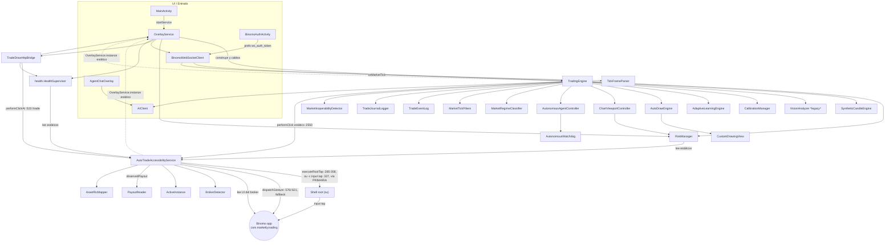

# ROUND 02 — Inventario técnico · TradeDraw R29-A

**Fecha:** 2026-11-09T07:18–07:26Z · **Ejecutado por:** DeepInvestigator (subagente de inventario, sesión Antigravity visible)
**Revisión del supervisor (07:40Z):** 3 correcciones materiales aplicadas in situ — E1 ruta root-tap PRIMARIA omitida, E2 14 estrategias (no 12), E3 cifras por-archivo con `git diff --numstat` — más menores (28 endpoints, `performClickAt:523`, 169 PNG, skips = `ReplayBacktestTest`).
**Alcance:** solo lectura. Única escritura: este archivo. Sin ejecutar la app, sin Gradle, sin ADB, sin AUTONOMOUS, sin broker, sin commits, sin secretos impresos.
**Método:** `find`/`grep`/`sed`/lectura directa + re-agregado de XML de resultados con Python (parseo de artefactos on-disk, no re-ejecución de la suite).

---

## 0. Resumen de estructura de directorios [VERIFICADO — `ls`/`find`]

```
Tradedraw/  (rama r10-night, HEAD c934835 = origin/r10-night; 22 entradas en git status, sin cambios durante esta ronda)
├── app/                          ← ÚNICO módulo Gradle (settings.gradle.kts: include(":app"))
│   ├── build.gradle.kts          AGP 8.5.2 · Kotlin 1.9.24 · compileSdk 34 · minSdk 24 · versionCode 21
│   └── src/
│       ├── main/java/com/example/tradedraw/   47 archivos Kotlin · 19.241 LOC
│       │   └── health/HealthSupervisor.kt     (único subpaquete)
│       ├── main/res/xml/         accessibility_service_config.xml, backup_rules, data_extraction_rules
│       └── test/java/.../        55 clases de test · 12.677 LOC
├── docs/                         ARCHITECTURE.md, QUANTITATIVE_BINARY_STRATEGIES_MASTER_TRADERS.md, agents/ (3 md, sin rastrear)
├── loops/                        ~50 informes de rondas R11→R29 (r27_validation/, r28a_verification/, r28b_autonomy/, r29a/)
├── workflows/                    51 archivos: preregistros R10–R26 + política de ejecución
├── validation_engine/            7 módulos Python de validación estadística
├── tests/                        6 suites Python (43 `def test_`)
├── scripts/                      analysis/ backtest/ ci/ ticks/ validation/ + td_supervisor.{sh,lock,log} + run_validation_pipeline.py + ~30 .py/.bat
├── data/                         fixtures/, ticks/, replay CSVs (datos de investigación)
├── specs/                        001-trade-reliability/{spec,plan,tasks}.md
├── .github/workflows/            android-build.yml (CI: SOLO build, sin paso de tests)
└── raíz: AGENTS.md, CLAUDE.md, TRADEDRAW_CURRENT_STATE.md, AUDIT_REPORT.md, VALIDATION_REPORT.md,
         LOSS_*.{md,csv,json}, FUTURE_HYPOTHESES.md, fast_trader_cli.py, _probe_*.js, 169 PNG de auditoría visual, 2 hs_err JVM
```

Stack externo ([VERIFICADO — `app/build.gradle.kts`, `gradle/libs.versions.toml`]): AndroidX Core/Lifecycle/Compose BOM 2024.04.01 + Material3, AppCompat 1.6.1, Material 1.11.0, ConstraintLayout 2.1.4, **OkHttp 4.12.0** (WebSocket + HTTP), JUnit 4.13.2, org.json 20240303. **Sin Room, sin DataStore, sin Hilt/Dagger, sin Retrofit, sin Coroutines explícitas** (loops con `Handler`/`Thread`/`Executors`). Gradle wrapper 9.5.0. CI (`android-build.yml`): checkout + JDK 17 + `assembleDebug` + upload de APK — **no ejecuta `testDebugUnitTest`** [VERIFICADO — lectura del yml].

---

## 1. Componentes Kotlin — motor y ejecución

### 1.1 TradingEngine — `app/src/main/java/com/example/tradedraw/TradingEngine.kt` (2.970 LOC) [VERIFICADO]

| Campo | Contenido |
| :--- | :--- |
| Responsabilidad | Orquestador central: evalúa estrategias sobre el feed, aplica cascada de vetos, decide, despacha la orden por tap de accesibilidad, confirma/liquida por movimiento de saldo, gestiona modos y telemetría. |
| Dependencias | ctor: `Context`, `CustomDrawingView`, `RiskManager`, `CalibrationManager?`, `AIClient` (`:40-46`). Crea: `ChartViewportController` (`:47`), `AutonomousAgentController` (`:48`), `VisionAnalyzer` (`:203`), `SyntheticCandleEngine`, `AdaptiveLearningEngine`, `MarketInoperabilityDetector`. Referencias: `binomoWebSocketClientRef` (`:404`), `feedFreshnessProvider` (`:364`), `AutoTradeAccessibilityService.*` (estáticos), `OverlayService.instance` (HUD, `:2599`, `:2646`), `TradeJournalLogger`, `TradeEventLog`, `MarketRegimeClassifier`, `MarketTickFilters`, `StrikeCalculator`. |
| Entradas | `onMarketTick(tick)` (`:468`, tick WS desde OverlayService:341), `onNewFrame(bitmap)` (`:554`, **sin llamadores activos** — visión retirada, VERIFICADO grep), comandos del bridge (`/trade`, `/mode`, `/strategy`), listeners de ATAS. |
| Salidas | `AutoTradeAccessibilityService.performClick(...)` (`:2013`, `:2550`), dibujo en HUD (`autoDrawEngine.drawTradeEntry` `:2560`), `TradeJournalLogger.logTrade/logShadowTrade`, `TradeEventLog.add`, Toasts, `HudSnapshot` (`:1553`), `/status` vía bridge. |
| Estado R27/R28 | No modificado en working tree (R1 §2.3). R28B: ejecución real vía `dispatchGesture` es taps reales; SHADOW termina en la decisión por diseño. |
| Riesgos | (1) `executeHeadlessTrade` ≈ 430 líneas monolíticas con ~10 vetos en línea (regla 15: cualquier extracción altera orden de evaluación). (2) Doble dependencia circular con OverlayService (estático `instance`) y con ATAS (estáticos). (3) `FEED_MAX_AGE_MS = BinomoWebSocketClient.DEFAULT_FRESHNESS_MS` (`:355`) — acoplamiento a constante del cliente WS. |
| Pruebas | `TradingEngineTest.kt` (860 LOC), `TradeIdEndToEndTest`, `DeterministicDecisionIdTest`, `PreregistroR12VetosTest`, `BuyExhaustionVetoTest`, `SellFilterHardeningTest`, `PriceFrozenDetectionTest`, `EntryWindowFlagTest`, `CooldownSubmodeSyncTest`, `PoderesDeMercadoEquivalenciaTest`, `ShadowModeTest`, `LiquidationIdempotencyTest`, `OrderConfirmationTest`, `NoProcesadaDiagnosticsTest`, `BalanceFreshnessSeparationTest`, `AssetMismatchGuardTest`, `AutonomousSafetyAndAssetScaleTest`. XML on-disk presentes para todas. |

**Cascada de vetos en `executeHeadlessTrade`** [VERIFICADO — lectura `:2158-2480`]:
1. Guard no-demo fail-closed (`:2178-2196`): `puedeOperarAutonomoEnDemo(isDemoAccount)` (`:869`) → si cuenta real: veto + `DISABLED` + evento `SEGURIDAD_NO_DEMO`.
2. Feed rancio (`:2198-2222`): edad de tick ≥ `FEED_MAX_AGE_MS` o `!isFeedFresh()` → veto + eventos `FEED_RANCIO`/`FEED_MUDO`.
3. Precio congelado V2 (`:2224-2260`): `recentPriceRangeRatio()` < umbral por familia de activo (`rangoRelativoMinimoParaActivo`, IDX→1e-11, resto→1e-5, `:858-868`).
4. Congelación declarada por WS, desajuste de activo (`motivoVetoPorDesajusteDeActivo`, `:948-960`, fail-closed RIC-vs-RIC), ventana de timing, y luego delegación a `RiskManager.canExecuteTrade` + `AdaptiveLearningEngine` antes del tap.

**Ruta real de ejecución de órdenes** [VERIFICADO — líneas exactas]:
```
TradingEngine.executeHeadlessTrade (TradingEngine.kt:2158)
  └─ TradingEngine.kt:2550  AutoTradeAccessibilityService.performClick(x, y, decisionId, tradeId) { … }
       └─ AutoTradeAccessibilityService.kt:190/182  fun performClick (companion) → guard puedeDespacharTap (:200) → dispatchClickGesture
            └─ AutoTradeAccessibilityService.kt:576  dispatchGesture(gesture, GestureResultCallback, null)
```
- **NO existe `OrderGateway`/`Broker`/`Executor` (interfaz)** [VERIFICADO — `grep -rn 'OrderGateway|interface .*Broker|interface .*Executor' app/src/main/java` → 0 coincidencias; coincide con R28B §4.1, que cita además la misma cadena en `TradingEngine.kt:2551-2566`].
- `dispatchGesture` = taps reales en pantalla (R28B:67). Fallback manual si falla en 300 ms (`triggerManualFallback`, `:2047`; timeout en `AutoTradeAccessibilityService.kt:558-561`).
- **CORRECCIÓN E1 (supervisor) — 3 primitivas de ejecución; root-tap es la PRIMARIA**: `performClick` (`ATAS:211-216`) documenta que "el root tap es la vía PRIMARIA y la accesibilidad el fallback" (Binomo/MIUI filtra gestos sintéticos). `hasRootAccess()` (`:246-260`, cachea `su -c id`) → `executeRootTap` (`:285-358`) ejecuta `Runtime.exec(arrayOf("su","-c","input tap x y"))` (`:327`) con su propio guard `puedeDespacharTap` (`:301-311`) y `restoreHudTouchable` en `finally` (`:353-356`). Con accesibilidad inactiva, `performClick` ejecuta root-tap + `autoHealAccessibility()` (`:238-243`), que re-registra el servicio vía root. El timeout de 300 ms aplica solo a la ruta de gesto. El diagrama §3 mostraba solo la ruta de gesto (corregido).
- Confirmación de orden por movimiento de saldo: `checkOrderConfirmation` (`:2587-2644`) → `RiskManager.isOrderConfirmed/isOrderUnprocessed`; `NO_PROCESADA` clasificada con evidencia disponible (R24/B4).
- Liquidación: `checkHeadlessTradeResolution` (`:2646+`) usa `isBalanceFresh` (`:925-926`: `instanceAvailable && nowMs-lastReadMs < 3000L`) — el guard del motor de 3000 ms que R27-H no tocó [VERIFICADO — código actual].
- **Ruta SHADOW** (`:2490-2525`): si `mode == SHADOW`, registra `shadowOrdersGenerated++`, evento `SHADOW_DECISION`, `TradeJournalLogger.logShadowTrade` y `return` **antes** de `recordTradeSent`/tap — no marca orden ni toca `hasPendingTrade` [VERIFICADO; coincide con R28B].
- **Ruta secundaria**: `triggerManualFallback` → `AutoTradeAccessibilityService.performClick` en `:2013` (misma primitiva de tap). Endpoint `/trade` del bridge llama `access.performClickAt(x, y)` directamente (`TradeDrawHttpBridge.kt:152-155`): pasa el guard demo (`performClickAt:532`) pero **se salta la cascada de vetos y `canExecuteTrade`** (riesgo documentado en §4).

### 1.2 AutoTradeAccessibilityService — `.../AutoTradeAccessibilityService.kt` (930 LOC) [VERIFICADO]

| Campo | Contenido |
| :--- | :--- |
| Responsabilidad | Servicio de accesibilidad: detecta app del broker en primer plano, lee saldo/activo/payout del árbol de UI (eventos `TYPE_WINDOW_STATE_CHANGED`, throttle 5000 ms), despacha gestos reales, publica estado global estático. |
| Dependencias | `ActiveInstance` (`:26`), `OverlayService.instance`, `BrokerDetector`, `RiskManager` (referencia), `AssetRicMapper`; receptor de broadcasts con permiso de firma `INTERNAL_COMMAND` (`:440-452`). |
| Entradas | `onAccessibilityEvent` (`:464`, único tipo: `typeWindowStateChanged` — config XML), broadcasts `TAP/SWIPE/BACK` (protegidos por firma), llamadas estáticas desde 11+ archivos. |
| Salidas | `dispatchGesture` (`:576` clicks, `:621` swipes), estáticos: `activeRef`/`instance` (`:26/:37`), `latestObservedBalance` (`:57`), `lastBalanceReadMs` (`:61`), `isDemoAccount` (`:65`, default `true`), `observedOrderAmount` (`:81`), `latestObservedAsset` (`:85`), `observedPayout`. |
| Estado R27/R28 | Diff working tree +51/−7 (R1 §2.3, numstat corregido): `ActiveInstance` atómica (L1) + `lastBalanceReadMs` estampado en ruta pasiva (C.1, `:481-485`). R27: `ACCESSIBILITY_DOWN` era falso positivo estructural en `duchamp`. |
| Riesgos | (1) Fan-out de estáticos a 11 archivos (grep VERIFICADO) — el principal punto de acoplamiento del sistema. (2) `isDemoAccount` se detecta por heurística de UI (`:704/:844`) — default `true` fail-open si la lectura falla, mitigado por guard de saldo en `canExecuteTrade`. (3) Glitch-guard de saldo: descarta lecturas <500K si previo >1M (`:646-648`). |
| Pruebas | `ActiveInstanceTest` (20 testcases, 424 LOC, concurrencia con latches — R28A §3), `BalanceFreshnessSeparationTest` (separación 3 s guard vs 10 s diagnóstico), cobertura indirecta en TradingEngineTest/AutonomousSafety. |

Ciclo de vida [VERIFICADO — `:418-521`]: `onServiceConnected`→`attach`+registro receptor; `onRebind`→`attach`; `onUnbind`→`detach`+`return true` (rebind); `onDestroy`→`detach`+unregister. `detach` compara por identidad (`ActiveInstance.kt:63+`, CAS).

### 1.3 RiskManager — `.../RiskManager.kt` (1.341 LOC) [VERIFICADO]

| Campo | Contenido |
| :--- | :--- |
| Responsabilidad | Política de capital y estado de orden: suelo de equity, stop de sesión, trailing profit lock, cooldowns, martingala/Soros, modo Sniper (M0, SL2/TP2/3 ops), máquina de estados de orden (ENVIADA→CONFIRMADA/NO_PROCESADA) e idempotencia de liquidación. |
| Dependencias | `SharedPreferences("TradeDraw_RiskConfig")` (`:17`), estáticos de ATAS (`latestObservedBalance`, `isDemoAccount`, `observedOrderAmount`), `CandleTimeframe`. |
| Entradas | `canExecuteTrade(subMode, confidence)` (`:714`), `recordTradeSent` (`:954`), `captureTapLatency` (`:1001`), `recordTradeWins/Losses/Void`, lecturas desde HUD cada ~400 ms. |
| Salidas | `(Boolean, motivo)` de `canExecuteTrade`; `OrderState` (`:272`: NINGUNA/ENVIADA/CONFIRMADA/NO_PROCESADA); `getEffectiveStake` (`:1277`); `isOrderConfirmed`/`isOrderUnprocessed` (`:590/:605`); `markOrderConfirmed`/`markOrderUnprocessed` (`:1019/:1031`); telemetría a `/stats`. |
| Estado R27/R28 | Sin diff (R1 §6: fuera de `git status`). Desviación R27: `BALANCE_STALE` = DEGRADED en diagnóstico, guard del motor intacto — confirmado por separación de umbrales en código actual. |
| Riesgos | (1) `isDemo` se infiere de saldo (`currentBal >= 1M` o flag, `:719-720`) — duplica la noción de cuenta de `ATAS.isDemoAccount` (dos fuentes de verdad, ya documentado en `TradingEngine.kt:2167-2177`). (2) YOLO desactiva límites de sesión por diseño (`:746-760`, comentado como riesgo declarado R23B). (3) `absoluteEquityFloor` default 20.000.000 COP (`:131`) — suelo demo altísimo por defecto. (4) Idempotencia: `liquidatedTradeIds` con clear total al llegar a 512 (`:496`) — ventana teórica de re-liquidación tras 512 trades. |
| Pruebas | `RiskManagerTest.kt` (1.199 LOC — la 2ª suite más grande), `LiquidationIdempotencyTest` (250 LOC), `OrderConfirmationTest`, `NoProcesadaDiagnosticsTest`, `JournalLatencySchemaTest`, `AutonomousSafetyAndAssetScaleTest`, `CooldownSubmodeSyncTest`. |

### 1.4 health/HealthSupervisor — `.../health/HealthSupervisor.kt` (260 LOC) [VERIFICADO]

| Campo | Contenido |
| :--- | :--- |
| Responsabilidad | Diagnóstico de salud (SOLO alimenta `GET /status`, no bloquea trading): máquina de estados READY/DEGRADED/BLOCKED sobre `Snapshot` inmutable. |
| Dependencias | Lee estáticos de ATAS y métodos de `TradingEngine`/`RiskManager`/`BinomoWebSocketClient` (via `evaluate` `:114-148`); `TradingEngine.motivoVetoPorDesajusteDeActivo` (`:186`). |
| Entradas | `Snapshot` (14 campos, `:68`), `DataSource` (`:49`: WEBSOCKET_PURO por defecto), `nowMs` inyectable. |
| Salidas | `Report(state, reasons, sinceMs, dataSource, notEvaluable)` con `toJson()` (`:93`). |
| Estado R27/R28 | Diff +164/−47 (R1 §2.3, numstat corregido): `evaluateFromSnapshot` pura, `SCREEN_FEED_MISMATCH`→notEvaluable sin pantalla, balance AUSENTE/INVALIDO/STALE, ventana `BALANCE_FRESH_WINDOW_MS` (10 s) separada del guard de 3 s. Verificado en dispositivo R27: `health READY` con notEvaluable. |
| Riesgos | BAJO: es de propósito diagnóstico; separación de umbrales fijada por `BalanceFreshnessSeparationTest`. |
| Pruebas | `health/HealthSupervisorTest.kt` (337 LOC, 20 testcases on-disk), `HealthDataSourceTest` (187 LOC, L2), `BalanceFreshnessSeparationTest`, `StatusJsonStrictSyntaxTest`. |

### 1.5 ActiveInstance — `.../ActiveInstance.kt` (86 LOC, sin rastrear) [VERIFICADO]

| Campo | Contenido |
| :--- | :--- |
| Responsabilidad | Referencia única y atómica a la instancia activa de un componente con ciclo de vida (genérica, sin Android). Invariante: una instancia antigua nunca libera la referencia de una más reciente (`AtomicReference.compareAndSet` por identidad). |
| Dependencias | Ninguna (JDK puro). |
| Entradas/Salidas | `promote(T)` / `detach(T): Boolean` / `current: T?`. |
| Estado R27/R28 | R27-H L1 (reescrita atómica por "agente previo"); R28-A la auditó y no la tocó; corrigió 1 prueba vacua. |
| Riesgos | BAJO. |
| Pruebas | `ActiveInstanceTest.kt` (424 LOC, 20 testcases XML on-disk — incluye prueba de concurrencia con latches R28A §3). [VERIFICADO] |

### 1.6 Motores de decisión (señales/estrategias) [VERIFICADO — ubicaciones, sin ejecutar nada]

- **Enum de estrategias**: `AutoDrawEngine.kt:4-22` — **14 estrategias** (`AUTO_ADAPTIVE`, 6× `MT_*` Master Traders, `COLOR_TREND`, `STRIKE_BREAKOUT`, `AI_REMOTE`, `SUPPORT_RESISTANCE`, `CANDLE_PATTERNS`, `TREND_FOLLOWING` (`:21`) y `COMBINED` (`:22`); ambas con ramas implementadas en el motor — `TradingEngine.kt:1430`, `:1451`, `:1824`, `:1827` — no son código muerto; exposición vía `/strategy` por verificar en Ronda 3). La lógica NO vive en `AutoDrawEngine` (que es dibujo): vive en `TradingEngine.evaluateStrategySignalWithReason` (`TradingEngine.kt:1061-1553`, ~490 líneas `when(strategy)`), con pre-filtros anti-choppy/lateral/timing (`:1066-1090`) y ramas por régimen (`MarketRegimeClassifier.classify`, `MarketRegimeClassifier.kt:30`). Submodo SNIPER: `evaluateSniperConfluences` (`:972`).
- **Filtros de tick**: `MarketTick.kt:47` (`MarketTickFilters` — ventanas estrictas :01-:05, veto :06-:57). Velas sintéticas e indicadores: `SyntheticCandleEngine.kt` (1.540 LOC). Clasificación de régimen: `MarketRegimeClassifier.kt` (153 LOC). Rango/velocidad: `TickVelocityLabel.kt`.
- **Aprendizaje adaptativo**: `AdaptiveLearningEngine.kt` (575 LOC; firma de contexto `TradeContextSignature:12`, bloqueo adaptativo — `extractAdaptiveSimPct:2861`), `TradeLearningEngine.kt` (129, object).
- Estado R27/R28: **ningún archivo de estrategia diffado** [VERIFICADO — R1 §2.4 grep sobre `git diff --name-only`]. Riesgo regla-15 heredado: el insumo del guard (`lastBalanceReadMs`, `instance`) SÍ cambió (R1 §2.3, pendiente Ronda 3).
- Pruebas: `MarketRegimeClassifierTest`, `SyntheticCandleEngineTest` (1.321 LOC, la mayor), `AdaptiveBlock{Parity,Threshold,Telemetry}Test`, `AdaptiveStateEndpointTest`, `PoderesDeMercadoEquivalenciaTest`, `ReplayRegimeVocabularyTest`.

---

## 2. Integración Binomo [VERIFICADO — lectura directa; sin valores de token impresos]

### 2.1 BinomoWebSocketClient — `.../BinomoWebSocketClient.kt` (869 LOC)

| Campo | Contenido |
| :--- | :--- |
| Responsabilidad | Feed de precios WSS: conexión, suscripción multi-formato, frescura, congelación, recuperación por ausencia de ticks, telemetría de desconexiones. |
| Dependencias | OkHttp WebSocket, `SharedPreferences("TradeDraw_WSConfig")` (`:21`), `TickFrameParser`, `TradeEventLog`, `OverlayService` (HUD). |
| Entradas | Tramas del servidor; `wsUrl`/`authToken`/`cookieHeader`/`deviceId` desde prefs; `activeAsset` (default `"Z-CRY/IDX"`, `:28`). |
| Salidas | Ticks → `onTick` listeners (OverlayService:341 → engine); estado `WebSocketState` (`MarketTick.kt:35`); `isFeedFresh()`, `isPriceFrozen()`, `socketTicks`, `activoSinFeed`, `recuperacionesPorSinTicks` (`:289`). |
| Estado R27/R28 | Sin diff. R28B: feed real del broker con token real de 36 caracteres; "DEMO" es etiqueta leída del broker, no sandbox. |
| Riesgos | (1) Protocolo documentado en código: cotizaciones = `{"action":"subscribe","rics":[RIC]}` plural + Phoenix v2 arrays posicionales (`:636-673`) — protocolo no contractual del broker, puede cambiar silenciosamente. (2) Reconexión con backoff propio; 401 → "requiere token" (`:615`). |
| Pruebas | `BinomoWebSocketClientTest` (180 LOC), `TickFrameParserTest`, `PriceFrozenDetectionTest`, `TicksEndpointTest`. |

- **Endpoint default**: `wss://ws.binomo.com/` (`:25`); `wss://as.binomo.com` referenciado en `subscribeToAsset` como mismo servicio (mismas IPs Cloudflare, `:636-638`) y en sondas `_probe_binomo_ws.js`/`scripts/ticks/record_ticks.js` [VERIFICADO — grep]. Override por prefs (`ws_endpoint_url`).
- **Autenticación**: token de sesión Binomo capturado por `BinomoAuthActivity` (WebView) y guardado en prefs `"TradeDraw_WSConfig"` clave `ws_auth_token` (`BinomoAuthActivity.kt:385-386`, `BinomoWebSocketClient.kt:205-206`). Se envía como query `authtoken=` + header `authtoken` + Cookie (`:530-547`). **Valor no impreso** (restricción de la misión). Logs sanitizados: `BinomoAuthActivity.kt:107` redacta `authtoken|token` de URLs; test `BinomoAuthSanitizationTest`. Riesgo: token en claro en SharedPreferences del dispositivo (sin EncryptedSharedPreferences) — documentado, no corregido.
- **Detección de app del broker**: `AutoTradeAccessibilityService.onAccessibilityEvent` filtra por `packageName` y actualiza `BrokerDetector.currentPackageName` (`ATAS.kt:469-472`); broker = `com.marketly.trading` (`scripts/td_supervisor.sh:50`). `BrokerDetector.kt` (31 LOC, object).

### 2.2 TradeDrawHttpBridge — `.../TradeDrawHttpBridge.kt` (985 LOC) [VERIFICADO]

- Micro-servidor HTTP propio (sin framework) sobre `ServerSocket` **enlazado solo a loopback** (`:40-44`, R13/B1; IPv6 `[::1]:8080` según supervisor). Acceso externo solo vía `adb forward`.
- **28 endpoints** (`when(path)` `:130-530`): lectura `/ping /status /frame /events /mode_log /mode_journal /shadow_journal /adaptive_state /ticks /diag_multiric /diag_inoperable /stats /nodes /hud`; escritura `/trade /strategy /mode /reset_stats /resume /sync_stats /win /loss /click /swipe /submode /calibrate /overlay /asset`. `performClickAt` está en `:523` (guard propio `:528-535`).
- Toda petición alimenta `noteBridgeHeartbeat()` (`:86`) → caducidad de AUTONOMOUS (R26).
- Riesgos: **`/trade`, `/click`, `/swipe` despachan taps reales** con solo el guard demo (`puedeDespacharTap`); `/trade` sin cascada de vetos ni `canExecuteTrade`; `/click`/`/swipe` además sin permiso HTTP (confían en loopback+ADB). `/mode` permite armar AUTONOMOUS (con caducidad por heartbeat). Sin autenticación HTTP (loopback como única frontera).
- Pruebas: `StatusJsonStrictSyntaxTest`, `ShadowJournalEndpointTest`, `TicksEndpointTest`, `AdaptiveStateEndpointTest`, `ModeTransitionAuditTest`, `JournalLatencySchemaTest`.

### 2.3 HUD y UI [VERIFICADO]

- `OverlayService.kt` (2.466 LOC, CRLF): foreground `specialUse`; **construye el grafo** (`:293` engine, `:341-356` wiring tick→engine y providers de frescura); `dataSource = WEBSOCKET_PURO` (`:130-131`, `:271` — captura de pantalla deshabilitada por producto, sin MediaProjection ni `ScreenCaptureManager` instanciado, `:88-91`, `:979`); HUD de ventanas con `WindowManager`.
- Vistas: `CustomDrawingView` (701), `ColorWheelView` (75), `AutoDrawEngine` (195, dibuja entradas/strikes), `ChartViewportController` (164), `StrikeCalculator` (235, geometría de strikes), `CalibrationManager` (343, coordenadas BUY/SELL por perfil de broker), `HudSnapshot` (75), `HudCoherence` (84), `DebugVisualizer` (129), `TemplateManager` (64), `AgentChatOverlay` (388, chat IA sobre overlay), `ModelPickerDialog` (222), `MainActivity` (169, launcher + arranque de OverlayService + settings de accesibilidad), `ui/theme/*` (3).
- Pruebas: `HudSnapshotTest`, `ChartViewportControllerTest`, `StrikeCalculatorTest`, `VisualHarnessTest`, `DrawShapeBotKeyTest`, `PayoutReaderTest`, cobertura indirecta de CalibrationManager.
- Estado R27/R28: OverlayService +33 (L2 `dataSource`); CRLF íntegro (R1 riesgo 4).

### 2.4 Componentes de soporte / IA / journals [VERIFICADO — tabla resumida]

| Componente | Ubicación (LOC) | Responsabilidad | Dependencias | Pruebas | Estado |
| :--- | :--- | :--- | :--- | :--- | :--- |
| `AIClient` | AIClient.kt (363) | Cliente IA remoto (chat + `AIAnalysisResult`); estrategia `AI_REMOTE` | prefs `TradeDraw_AIConfig`, red | — (sin test dedicado) | Activo vía HUD/chat; `TradingEngine:1743` |
| `AgentChatOverlay` | AgentChatOverlay.kt (388) | Overlay de chat con el agente IA | OverlayService, AIClient | — | Activo |
| `AutonomousAgentController` | AutonomousAgentController.kt (174) | Control del modo autónomo desde UI/IA | engine, RiskManager, ATAS | `AutonomousWatchdogTest`, `ModeTransitionAuditTest` | Activo |
| `AutonomousWatchdog` | AutonomousWatchdog.kt (55) | Caducidad de AUTONOMOUS sin heartbeat | handler | `AutonomousWatchdogTest` | Activo (R26) |
| `TradeJournalLogger` | TradeJournalLogger.kt (385) | CSV de trades/shadow en `filesDir/TradeDraw_Audits` (+ sync a externo) | Context, File | `TradeJournalLoggerTest`, `JournalLatencySchemaTest`, `LiveReplayParityTraceabilityTest` | Activo |
| `TradeEventLog` | TradeEventLog.kt (247) | Anillo en memoria de eventos (`/events`); vetos/decisiones | — | `TradeEventLogTest`, `ModeChangeEventTest` | Activo |
| `ModeEventJournal` | ModeEventJournal.kt (84) | Journal de transiciones de modo en archivo | File | `ModeTransitionAuditTest`, `ModeRingDedicadoTest` | Activo |
| `MarketInoperabilityDetector` | MarketInoperabilityDetector.kt (216) | Detecta mercado inoperable (ticks bajos sostenidos) | ticks | `MarketInoperabilityDetectorTest` | Activo |
| `SyntheticCandleEngine` | SyntheticCandleEngine.kt (1540) | Velas/RSI/S-R desde ticks | MarketTick | `SyntheticCandleEngineTest` (mayor suite) | Activo (núcleo del análisis) |
| `VisionAnalyzer` | VisionAnalyzer.kt (1252) | **HERENCIA de visión**: parsea bitmap → `VisionAnalysisResult`; hoy el análisis se construye desde ticks (`TradingEngine:505` `buildAnalysisFromSyntheticEngine`) | — | `VisionAnalyzerTest` (498) | **Legacy vivo**: `onNewFrame` sin llamadores [VERIFICADO grep]; estructuras reutilizadas |
| `PayoutReader` / `AssetRicMapper` / `TickFrameParser` / `BrokerDetector` / `CandleTimeframe` / `TradingTool` / `TickVelocityLabel` / `CrashLogger` | (ver §0 rutas) | Payout observado · mapeo nombre↔RIC · parseo de tramas WS · detección de broker en foreground · timeframes · tipo de instrumento · etiqueta de velocidad · log de crash | prefs/estáticos ATAS | `PayoutReaderTest`, `AssetRicMapperTest`, `TickFrameParserTest` | Activo |
| `CalibrationManager` | CalibrationManager.kt (343) | Coordenadas BUY/SELL por broker y orientación | prefs `TradeDraw_Calibration` | indirecta | Activo |

### 2.5 Servicios y permisos Android [VERIFICADO — AndroidManifest.xml]

| Componente manifest | Detalle |
| :--- | :--- |
| `MainActivity` (`:23-38`) | `exported=true`, LAUNCHER. |
| `BinomoAuthActivity` (`:41-47`) | `exported=true`, "Vinculación Binomo" (WebView de login → token). |
| `OverlayService` (`:49-53`) | `exported=false`, `foregroundServiceType="specialUse"`. |
| `AutoTradeAccessibilityService` (`:55-66`) | `BIND_ACCESSIBILITY_SERVICE`, `exported=true` (exigido por el sistema), meta-data `@xml/accessibility_service_config`. |
| Permisos (`:6-12`) | `SYSTEM_ALERT_WINDOW`, `FOREGROUND_SERVICE(_SPECIAL_USE)`, `INTERNET`, `ACCESS_NETWORK_STATE`, `VIBRATE`, `WAKE_LOCK`. |
| Permiso de firma (`:20-22`) | `com.example.tradedraw.permission.INTERNAL_COMMAND` (protege receptores TAP/SWIPE/BACK; vector R15-A cerrado en R16-A). |
| `accessibility_service_config.xml` | `typeWindowStateChanged`, `feedbackGeneric`, `flagRetrieveInteractiveWindows`, **`canPerformGestures=true`**, `canRetrieveWindowContent=true`, timeout 200 ms. |
| Backup | `allowBackup=true` + reglas XML — **el token de `TradeDraw_WSConfig` puede salir en backups del dispositivo** (riesgo, §4). |

### 2.6 Persistencia [VERIFICADO — grep `getSharedPreferences`]

| Almacén | Claves/contenido | Consumidores |
| :--- | :--- | :--- |
| `TradeDraw_WSConfig` (6 usos) | `ws_endpoint_url`, **`ws_auth_token`**, `ws_active_asset`, cookie/device-id | BinomoWebSocketClient, BinomoAuthActivity |
| `TradeDraw_HUDConfig` (4) | preferencias HUD | OverlayService |
| `TradeDraw_Config` (2) | config general | MainActivity/OverlayService |
| `TradeDraw_RiskConfig` (1) | parámetros de riesgo (equity floor, martingala, soros payout…) | RiskManager |
| `TradeDraw_Calibration` (1) | coordenadas de tap | CalibrationManager |
| `TradeDraw_Templates` (1) | plantillas de dibujo | TemplateManager |
| `TradeDraw_AIConfig` (1) | modelo/IA | AIClient |
| Archivos | `filesDir/TradeDraw_Audits/` (CSV trades + shadow), `adaptive_learning_state.json`, journal de modos; external `getExternalFilesDir` con sync interno→externo | TradeJournalLogger, AdaptiveLearningEngine, ModeEventJournal |
| **NO existe** | Room, DataStore, EncryptedSharedPreferences, WorkManager | — |

### 2.7 Backtesting / Replay / Validación estadística [VERIFICADO — presencia; ejecución NO realizada]

- **Replay JVM**: `ReplayBacktestTest.kt` (633 LOC; reproduce ticks CSV en `data/` contra el motor real, Ronda 9), `ReplayLatencyModeTest`, `LiveReplayParityTraceabilityTest` (338), `ReplayRegimeVocabularyTest`. Fixtures: `data/fixtures/`, `data/replay_*.csv`, `data/ticks/`.
- **`validation_engine/`** (Python, 7 módulos): `data_integrity_validator`, `temporal_integrity_validator`, `no_look_ahead_validator`, `statistical_validator` (Wilson CI, p-value vs break-even, bootstrap Monte Carlo, estados `INSUFFICIENT_SAMPLE/POTENTIAL_LOOKAHEAD/POTENTIAL_OVERFIT/VALID_FOR_RESEARCH`), `out_of_sample_validator`, `execution_model`, `simulation_validation_engine`. Orquestador: `scripts/run_validation_pipeline.py`.
- **Suite Python `tests/`**: 6 archivos con **43 `def test_`** [VERIFICADO — conteo grep; coincide con el claim de TEST_MATRIX §4 en `loops/r27_validation/TEST_MATRIX.md`]. **Estado: SIN VERIFICAR por ejecución** (regla de la misión: no regenerar artefactos; sin artefacto de resultados on-disk — coincide con R1 §5).
- Scripts auxiliares: `scripts/backtest/{replay,evaluate,compare_feeds,null_baseline,data_quality}.py`, `scripts/validation/compare_live_replay*.py` + monitores `live_monitor_r2*.py` + `test_action_telemetry.py` etc., `scripts/analysis/reconcile_canonical_trades.py`, `scripts/ci/verify_clean_worktree.py`, `scripts/ticks/record_ticks.js`.

### 2.8 Scripts de operación y dependencias externas [VERIFICADO]

- `scripts/td_supervisor.sh` (293 líneas, sin rastrear): supervisor ADB del bot en Termux (Poco X6 Pro); sondea `[::1]:8080`, recupera el servicio (toggle accesibilidad, abrir MainActivity, tocar INICIAR OVERLAY), `AUTO_REARM=1` por defecto re-arma AUTONOMOUS. **No ejecutado en esta ronda**; lock obsoleto no tocado (regla 7). Log termina 2026-11-07T18:27:41Z (R1 §3).
- `fast_trader_cli.py` (raíz): CLI de operador; `adb forward tcp:8080 tcp:8080` + llamadas HTTP al bridge (ejecuta órdenes vía `/trade`).
- `_probe_binomo_ws.js`, `_probe_asset_volatility.js`: sondas Node read-only del protocolo WS (sin credenciales, "NO opera").
- Issue tracker: GitHub `Mizaring467/Tradedraw` vía `gh` (`CLAUDE.md:111`, `docs/agents/issue-tracker.md`) — referencia documental; no se contactó a GitHub en esta ronda.
- CI: `.github/workflows/android-build.yml` — solo `assembleDebug` en push/PR a `main` (rama activa es `r10-night`, 212 commits por delante de `main` según R1 §1: CI actual no cubre la línea de trabajo ni ejecuta tests).

---

## 3. Diagrama de dependencias (quién llama a quién) [VERIFICADO — grep de referencias]



Fan-in de estáticos [VERIFICADO — `grep -rl 'AutoTradeAccessibilityService\.'`]: `MainActivity`, `OverlayService`, `AgentChatOverlay`, `AutonomousAgentController`, `RiskManager`, `TradingEngine`, `AssetRicMapper`, `ChartViewportController`, `TradeDrawHttpBridge`, `HealthSupervisor`, `ActiveInstance` (11 archivos). Ciclos existentes: `TradingEngine ↔ OverlayService` (estático `instance`), `TradingEngine ↔ ATAS` (estáticos ↔ listeners), `OverlayService ↔ ATAS`. `RiskManager` es referenciado por 11 archivos; `OverlayService` por 14.

---

## 4. Riesgos transversales [VERIFICADO salvo donde se indica]

1. **Monolito de un solo módulo** — 47 clases en un paquete plano + `health/`; frontera única: la APK entera. La modularización R29-B exigirá extraer `engine/`, `broker/`, `execution/`, `health/`, `ui/`, `journal/`.
2. **Estado global estático como columna vertebral** — `ATAS.*` (11 consumidores), `OverlayService.instance`, `TradeEventLog`, `TradingEngine.motivoVetoPorDesajusteDeActivo` consumido por health. Inyectable solo con refactor (R28B ya recomendaba fuente inyectable — L2 hecho solo para health).
3. **Sin frontera de ejecución** — no existe `OrderGateway`/interfaz de broker [VERIFICADO — grep 0 coincidencias]; **4 vías** despachan taps reales: (a) `executeHeadlessTrade` (con cascada completa de vetos), (b) `/trade` del bridge (`performClickAt` directo, **sin** `canExecuteTrade` ni vetos de timing/feed), (c) broadcasts TAP/SWIPE firmados, (d) **root-tap directo** (`executeRootTap`, operativa incluso con el servicio de accesibilidad inactivo, `ATAS:238-243`) — los botones CALL/PUT del HUD también llaman `performClickAt` (`ATAS:529`). Riesgo regla-15 a documentar para Ronda 3: (b), (c) y (d) son puertos de ejecución con guard mínimo o nulo aguas abajo.
4. **Dualidad demo/real heurística** — `ATAS.isDemoAccount` (UI) vs `RiskManager.isDemo` (saldo ≥1M) (`RiskManager.kt:719-720`); dos fuentes de verdad reconocidas en comentarios del propio código (`TradingEngine.kt:2167-2177`).
5. **Doble umbral de frescura de balance** — guard motor 3.000 ms (`TradingEngine.kt:925-926`) vs diagnóstico 10.000 ms (`HealthSupervisor` `BALANCE_FRESH_WINDOW_MS`); separación intencional (R27-H L3) y fijada por test.
6. **Token de sesión en claro** en `SharedPreferences` sin cifrar + `allowBackup=true` → puede viajar en backups del dispositivo. Sin EncryptedSharedPreferences. (Documentado; no corregido — regla 15.)
7. **Heredados de R1** (no re-auditados aquí): trabajo R27/R28 solo en working tree; supervisor con AUTO_REARM=1; APK instalada v20 ≠ working tree v21; CRLF en OverlayService.
8. **CI no ejecuta tests ni cubre `r10-night`** — la suite JVM corre solo en máquinas locales.
9. **PARCIALMENTE VERIFICADO**: `docs/ARCHITECTURE.md` describe el flujo headless correctamente pero con nombres parciales (no menciona health, journals ni bridge) — desfasada en profundidad, no en dirección.

---

## 5. Sistema de pruebas — estado por componente [VERIFICADO — agregado de XML on-disk con Python; sin re-ejecutar Gradle]

**Hallazgo NUEVO de esta ronda:** el agregado bruto de `app/build/test-results/testDebugUnitTest/` da 58 XML / 573 tests (lo que R28A §4 certificó), pero **3 XML corresponden a clases cuya fuente ya no existe** (`AssetRicMappingTest`, `HudGeometriaTest`, `OrderStateReposoTest` — diff fuente↔XML VERIFICADO con script; las fuentes actuales son 55). Excluyéndolos: **55 clases / 565 tests / 0 fallos / 0 errores / 2 skipped vigentes** (los 8 tests restantes viven en XML obsoletos). El claim "573/58" está inflado por artefactos residuales de Gradle; la diferencia es coherente con la progresión documentada, pero no se puede certificar sin ejecutar Gradle (prohibido aquí). **Nota del supervisor:** los 2 skipped vigentes son ambos de `ReplayBacktestTest` (su XML: `tests="2" skipped="2"`, timestamp 2026-11-05T23:58, mismo lote que los 3 obsoletos) — la suite insignia de replay quedó íntegramente sin ejecutar en la última corrida registrada; causa pendiente de explicar en Rondas 3/5 (¿assumptions? ¿fixtures ausentes?).

| Área | Clases de test (todas con XML vigente salvo indicación) |
| :--- | :--- |
| Motor/estrategia | TradingEngineTest, MarketRegimeClassifierTest, SyntheticCandleEngineTest, PreregistroR12VetosTest, BuyExhaustionVetoTest, SellFilterHardeningTest, PriceFrozenDetectionTest, EntryWindowFlagTest, PoderesDeMercadoEquivalenciaTest, DeterministicDecisionIdTest |
| Ejecución/orden | OrderConfirmationTest, NoProcesadaDiagnosticsTest, LiquidationIdempotencyTest, TradeIdEndToEndTest, ShadowModeTest, BalanceFreshnessSeparationTest |
| Riesgo | RiskManagerTest, AutonomousSafetyAndAssetScaleTest, CooldownSubmodeSyncTest, JournalLatencySchemaTest |
| Accesibilidad/ciclo de vida | ActiveInstanceTest, HealthDataSourceTest, health.HealthSupervisorTest |
| WS/feed | BinomoWebSocketClientTest, TickFrameParserTest, TicksEndpointTest, PriceFrozenDetectionTest, MarketInoperabilityDetectorTest, TickVelocityLabelTest |
| Replay/backtest | ReplayBacktestTest, ReplayLatencyModeTest, ReplayRegimeVocabularyTest, LiveReplayParityTraceabilityTest |
| Journals/telemetría | TradeJournalLoggerTest, TradeEventLogTest, ModeChangeEventTest, ModeTransitionAuditTest, ModeRingDedicadoTest, ShadowJournalEndpointTest, StatusJsonStrictSyntaxTest, AdaptiveBlock{Parity,Threshold,Telemetry}Test, AdaptiveStateEndpointTest |
| HUD/UI/otros | HudSnapshotTest, ChartViewportControllerTest, StrikeCalculatorTest, VisualHarnessTest, DrawShapeBotKeyTest, PayoutReaderTest, AssetRicMapperTest, AssetMismatchGuardTest, VisionAnalyzerTest, AutonomousWatchdogTest, BinomoAuthSanitizationTest, ExampleUnitTest |
| **Sin test dedicado** | AIClient, AgentChatOverlay, ModelPickerDialog, MainActivity, BinomoAuthActivity (parcial), TemplateManager, ColorWheelView, CrashLogger, DebugVisualizer, OverlayService (solo endpoints), vistas HUD — UI pura sin cobertura JVM |
| Python | tests/ 43 `def test_` — **SIN VERIFICAR por ejecución** (sin artefacto local; comando reproducible según `loops/r27_validation/TEST_MATRIX.md`) |

---

## 6. Criterios de aceptación de la ronda

- [x] Proyecto completo examinado por lectura directa (`find`/`grep`/`sed`/read); 47 Kotlin main + 55 test + manifest + gradle + scripts + docs + tests Python inventariados. [VERIFICADO]
- [x] Clases mínimas exigidas cubiertas en profundidad: TradingEngine (§1.1), AutoTradeAccessibilityService (§1.2), RiskManager (§1.3), HealthSupervisor (§1.4), WS Binomo (§2.1), ruta de ejecución (líneas exactas `:2550`→`:576`). [VERIFICADO]
- [x] Servicios/permisos/accessibilityconfig (§2.5). Motores de decisión ubicados sin ejecutar nada (§1.6). Integración Binomo con ubicación del token SIN imprimir valor (§2.1). HUD (§2.3). Persistencia (§2.6). Backtesting/replay/validación (§2.7). Suites de pruebas (§5). Dependencias externas (§0, §2.8). [VERIFICADO]
- [x] Ausencia de OrderGateway re-verificada negativamente con grep propio (coincide con R28B). [VERIFICADO]
- [x] 8 campos por componente (Nombre·Ubicación·Responsabilidad·Dependencias·E/S·Estado R27/R28·Riesgos·Pruebas). Diagrama de dependencias con fan-in medido. [VERIFICADO]
- [x] Cada afirmación etiquetada; sin ejecución de app/Gradle/ADB/AUTONOMOUS/broker; sin commits; sin secretos impresos; única escritura: este archivo. Sin cambios en `git status` durante la ronda (22 entradas, idénticas a R1).
- [x] Hallazgo nuevo documentado (XML de test obsoletos, §5) sin alterar ningún artefacto.

## 7. Veredicto

**RONDA 2 COMPLETADA — APROBADA.** TradeDraw es un monolito Android de un solo módulo con 47 clases Kotlin (19.241 LOC) cuyo núcleo es el par TradingEngine (decisión+veto+ejecución) y AutoTradeAccessibilityService (percepción+acción sobre el broker), sostenidos por estado estático global (11 consumidores de `ATAS.*`) y un bridge HTTP loopback de 28 endpoints. La ejecución dispone de **3 primitivas de tap real** — gesto de accesibilidad (`dispatchGesture`, `ATAS:576`), **shell root** (`su -c input tap`, `ATAS:327`, vía primaria según el propio código, operativa incluso con la accesibilidad caída) y bridge HTTP (`performClickAt`, `:523`, usado también por los botones CALL/PUT del HUD) — sin ninguna abstracción de orden (OrderGateway ausente, re-verificado) — el bloqueo de R28B se confirma sobre el código actual. La lógica de estrategias vive íntegramente en `TradingEngine.evaluateStrategySignalWithReason` (`:1061-1553`) y no fue leída con fines de modificación ni tocada. Pruebas: 55 clases JVM vigentes (565 tests, 0 fallos, 2 skipped según XML on-disk; el claim 573/58 de R28A incluye 3 XML obsoletos — hallazgo nuevo), 43 tests Python sin verificar por ejecución. Bloqueos: ninguno nuevo. Insumos clave para Ronda 3: puertos de ejecución sin cascada de vetos (`/trade`, `/click`), dualidad demo/real, ciclo unbind→rebind y token sin cifrar.
