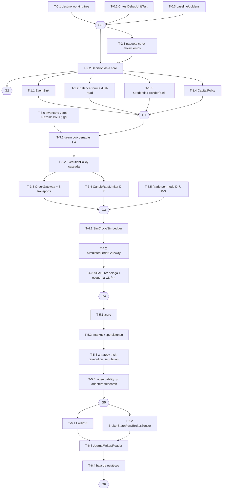

# ROUND 06 — Plan de migración R29-B · TradeDraw R29-A

**Fecha:** 2026-11-09T09:40Z · **Ejecutado por:** DeepInvestigator (subagente de planificación, sesión Antigravity visible)
**Alcance:** DISEÑO del plan incremental de R29-B. Sin implementar código, sin crear módulos, sin tocar `app/`. Única escritura: este archivo. Sin commits, sin Gradle/ADB/AUTONOMOUS/broker, sin secretos.
**Método:** insumos R2–R5 como hechos establecidos (no se repite su inventario) + re-verificación con `grep`/`sed` de TODA cifra heredada usada aquí antes de etiquetarla VERIFICADO (lección D-5/E3: R6 re-colectó hoy los 14 sitios `Kind.VETO`, los headers CSV, los estáticos de `lastExecutedCandleEpochMinute`, el CI y `settings.gradle.kts`).
**Convención:** **VERIFICADO** = comando o `ruta:línea` re-ejecutado hoy sobre el working tree (HEAD `c934835` + trabajo R27/R28 sin commit). **HEREDADA** = cifra tomada de un informe anterior sin re-ejecutar (se indica fuente). **PROPUESTA** = diseño nuevo para R29-B; ninguna PROPUESTA contradice un hecho VERIFICADO ni un congelado de R4 §7.

---

## 1. Precondiciones y bloqueadores (día 0, antes de T-1.1) [VERIFICADO]

| # | Precondición | Estado hoy (evidencia) | Opciones | Recomendación | Bloquea a |
| :-- | :--- | :--- | :--- | :--- | :--- |
| P-1 | **Destino del working tree R27/R28 sin commit** | 10 modificados (+691/−109, `git diff --numstat` 2026-11-09, incluye los informes R5 en `docs/`) + 17 rutas sin rastrear = 27 entradas; todo el trabajo R27/R28 vive solo en working tree (R1 §2–3, R0 §2.5; cifras re-estampadas por revisión — las originales "9M/+582/−109/13U" eran snapshot de R1) | (a) commit único del trabajo tal cual en `r10-night`; (b) branch dedicado `r27-r28-work` + commit + merge posterior; (c) seguir sin commit y refactorizar solo archivos no-diffados | **(a)**: R1 certificó el working tree «íntegro y explicable al 100 %», 0 archivos de estrategia diffados, 573 tests en XML on-disk (565 vigentes, ver P-2/G0); el riesgo dominante es la PÉRDIDA (R1 §8.1, ALTO). (c) es inviable para F3/F6: los archivos diffados incluyen `AutoTradeAccessibilityService.kt`, `OverlayService.kt`, `TradeDrawHttpBridge.kt` — justo los objetivos de F3/F6 | **TODA tarea que toque esos archivos** (T-3.3, T-3.5, T-6.x); sin P-1, F2/F1 (que no los tocan) podrían iniciar bajo riesgo asumido — no recomendado |
| P-2 | **CI ejecutando `testDebugUnitTest` en `r10-night`** | `.github/workflows/android-build.yml`: solo `assembleDebug`, disparadores solo `main` (push/PR) [VERIFICADO hoy: lectura del yml]; `settings.gradle.kts` = `include(":app")` único módulo [VERIFICADO hoy] | (a) añadir paso `-Phase "./gradlew testDebugUnitTest"` y trigger de `r10-night` al yml existente; (b) workflow nuevo `android-tests.yml` | **(a)** — un solo yml, cambio mínimo; el gate G0 exige un run CI verde con la suite vigente re-agregada al momento del gate (última observación en disco 2026-11-09: 573 testcases / 0F / 0E / 2 skipped en 58 XML, 3 de ellos obsoletos → 565 vigentes en 55 clases; 2 skipped = `ReplayBacktestTest` por env-vars ausentes, R3 §2.8d) | T-0.2 → gate G0 → todo lo demás |
| P-3 | **Autorización explícita: re-ruta de `/trade` por modo (D-7)** | `/trade` (`bridge:141-159`) hoy ignora `mode`; despacha tap real en DISABLED/SHADOW con solo el guard heurístico (R3 §2.4) | autorizar / aplazar indefinidamente | Añade vetos a una vía que hoy no los tiene → cambio de comportamiento deliberado (reglas 6/15). Sin autorización: T-3.5 se elimina del DAG y D-7 queda parcial (solo rate-limit, T-3.4) | T-3.5 únicamente |
| P-4 | **Autorización explícita: SHADOW→ciclo simulado (F4) + versión de esquema del `shadow_journal`** | SHADOW es log-and-return (`TE:2492-2518`, `return` en :2518); el ciclo simulado cambia `shadow_journal.csv` (consumidores: validadores Python) | autorizar con esquema v2 versionado / mantener log-only (flag off permanente) | Alternativa conservadora ya prevista en R4 §6 F4: ciclo tras flag, log-only por defecto | T-4.3 (T-4.1/T-4.2 pueden construirse apagadas) |

Notas: (i) la suite Python (43 tests) está SIN VERIFICAR por ejecución (R5) — no bloquea el plan JVM; se añade como gate opcional en G6. (ii) `opencode` estuvo activo en R0 (riesgo de edición concurrente) → re-verificar `git status` antes de cada escritura (P-1 incluye esto).

---

## 2. Reglas transversales del plan (contrato de ejecución de R29-B) [VERIFICADO + PROPUESTA]

1. **Congelados absolutos (R4 §7; tocas el cuerpo = STOP regla-15):** interior del `when` de 14 estrategias (`TE:1061-1553`); orden de la cascada de vetos (`TE:2178-2460`); esquemas CSV — trades 29 col. (`TradeJournalLogger.kt:22`) y shadow 11 col. (`:227-228`) [VERIFICADO hoy, headers literales]; algoritmo de `decisionId` (`TE:914-920`, `UUID.nameUUIDFromBytes("${ric}_${nonceMs}_${ACTION}")` [VERIFICADO hoy]); heurística demo/real (`ATAS:701-707/:841-847`, default true — solo se envuelve); ruta root-tap/auto-heal (`ATAS:215-243, 285-358, 379-390`); defaults de `RiskManager` (suelo demo 20M COP `:131`, YOLO `:746-760`); token en prefs sin cifrar (aplazado).
2. **Flag regla-15 obligatorio:** toda tarea con «Riesgo: Alto» lleva mecanismo de mitigación explícito (equivalencia veto-a-veto, dual-read, o flag off por defecto). El estado por defecto de cada flag = comportamiento actual.
3. **Estilo de inyección:** constructores + lambdas + `ActiveInstance<T>`; sin Hilt/Dagger, sin Coroutines, sin ServiceLocator global nuevo (R4 §1; el wiring de Market Data `OverlayService.kt:339-366` es el patrón).
4. **0 interfaces hoy** en `app/src/main/java` [VERIFICADO hoy: `grep -rn "interface " app/src/main/java` → 0]. Cada contrato nuevo es la primera interfaz de su paquete; el plan las introduce como aditivas con impl-delegada-al-estático.
5. **Los tests nunca se revierten** (acumulan la red de seguridad; ver §7). Baseline: **573 testcases / 58 XML / 0F / 0E / 2 skipped en disco (2026-11-09); 565 vigentes en 55 clases** tras excluir 3 XML obsoletos de clases renombradas (re-agregado propio hoy; corrige el "565" heredado de R2 §5 — lección D-5/E3 aplicada tarde). El gate G0 re-agrega al ejecutarse: la cifra puntual no es el contrato, el procedimiento de re-agregado sí.
6. **CRLF:** `OverlayService.kt` es 100 % CRLF (2466/2466; heredada de R3 §2.9a) — toda edición suya debe preservar EOL; sin `.gitattributes` (no crear uno en R29-B sin autorización).
7. **Código legacy congelado in situ:** `VisionAnalyzer` (1.252 LOC) y la ruta visión `onNewFrame`→`executeAutonomousTrade` (`TE:554`, `:1964`; `onNewFrame` sin llamadores en producción [VERIFICADO hoy: grep → solo un comentario en `TradingEngineTest.kt:638`]) NO se migran (R4 §7.8; regla 7).

---

## 3. T-3.0 — Inventario veto-por-veto de la cascada (entregable congelado de R6) [VERIFICADO hoy]

Gap de la revisión de R4 (§14): R29-B no puede extraer la cascada sin un oráculo sitio-a-sitio. Re-colectado hoy con `grep -n "Kind.VETO" TradingEngine.kt` + lectura `:2158-2470`:

| # | Línea (`TradingEngine.kt`) | Veto (nombre operativo) | Mensaje del evento `Kind.VETO` | Condición / función | Efectos secundarios a preservar |
| :-- | :-- | :--- | :--- | :--- | :--- |
| G | :2186 | **GUARD DEMO** (no cuenta como veto; R4: 13 = 14 − guard) | `SEGURIDAD_NO_DEMO cuenta_real_bloqueada` | `mode==AUTONOMOUS && !puedeOperarAutonomoEnDemo(ATAS.isDemoAccount)` (`:869` = identidad) | `setTradingMode(DISABLED, "seguridad:no-demo")` |
| 1 | :2210 | Feed rancio | `FEED_RANCIO ageMs=… activo=…` | `tickAgeMs==null || >= FEED_MAX_AGE_MS || !isFeedFresh()` (`:2198-2204`) | + evento `FEED_MUDO` (:2216-2221) si `tickAgeMs==null` |
| 2 | :2251 | Precio congelado V2 (sin volatilidad) | `V2 rango=… umbral=… activo=…` | `rangoRelativo < rangoRelativoMinimoParaActivo(asset)` (`:858-859`, IDX→1e-11) | — |
| 3 | :2269 | Congelación declarada por WS | `CONGELADO activo=…` | `isPriceFrozen()` | — |
| 4 | :2300 | Desajuste pantalla↔feed | `motivoDesajuste` (dinámico) | `motivoVetoPorDesajusteDeActivo` (pura, fail-closed) | `vetoActivoDesajustado++` |
| 5 | :2308 | 1 orden por vela | `VELA_YA_OPERADA minuto=…` | `lastExecutedCandleEpochMinute == currentCandleEpochMinute` (bloque `synchronized`, `:2305-2311`) | lee/scruta estado compartido con SHADOW (D-7, escritura SHADOW en `:2516`, real en `:2541`) |
| 6 | :2324 | Francotirador | `FRANCOTIRADOR activo=…` | `isSniper && isSynthetic && estrategia no exceptuada` (`:2322`: MT_MASTER_COMBO/AUTO_ADAPTIVE/SUPPORT_RESISTANCE/MT_REJECTION pasan) | — |
| 7 | :2333 | Ventana timing | `FUERA_DE_VENTANA sec=…` | `!MarketTickFilters.isInEntryWindow(sec)` (`MarketTick.kt:73`) | — |
| 8 | :2345 | Anti-choppy | `CHOP` | `isChoppinessDetected() && !isRejectionOrBounce` (lista MT_*+QUANT_CRYPTO `:2336-2342`) | — |
| 9 | :2358 | Cooldown post-resolución | `COOLDOWN …ms` | espaciado 8 s (YOLO) / 35 s (loss-streak) / 12 s (`:2351-2355`) | — |
| 10 | :2380 | Agotamiento de compra (R23H) | `motivoVeto` (pura) | `motivoVetoPorAgotamientoDeCompra(action, trend, callPower)` — solo BUY; va ANTES del adaptativo a propósito (`:2369-2371`) | — |
| 11 | :2402 | Bloqueo adaptativo | `buildAdaptiveBlockDetail(reason, reasonDescription)` | `AdaptiveDecision.Block` de `adaptiveLearningEngine.evaluateSignalSuitability` (`:2384-2410`) | Toast «⛔ [Autoaprendizaje]…» (`:2406-2408`) |
| 12 | :2427 | Riesgo (CapitalPolicy) | `RISK_LIMIT $riskReason` | `!riskManager.canExecuteTrade(subMode, headlessConfidence)` (`:2424`; confianza derivada `:2423`) | si sniper y motivo de límite: `setTradingMode(DISABLED)` + Toast + `OverlayService.instance?.updateHUDView()` (`:2428-2435`) |
| 13 | :2455 | Conflicto S/R↔Plan (V1) | `V1 SR="…" PLAN="…"` | `HudCoherence.actionConflict(srFilterStatus, actionPlan)` (`:2446-2460`) | — |

Tras el veto 13, la cascada resuelve coordenadas DENTRO de la cola (`CalibrationManager.getRealScreenDimensions(context)` `:2462`, calibración/defaults `:2465-2470`, sanitización Y `:2473-2481`) — el seam E4 de R4. **Hallazgo nuevo R6 (re-clasificado por revisión del supervisor, 09:50Z):** existe un 15.º sitio `Kind.VETO` en `:1867` — dentro de `handleSignal` (`:1833`), **alcanzable en PRODUCCIÓN hoy** vía `onMarketTick` (`:468`) → `:758`; la ruta visión (`onNewFrame:554` → `executeAutonomousTrade:1964`, sin llamadores en producción) es una función distinta que nunca llega a :1867. El sitio emite BuyExhaustion SIN `decisionId`. Queda FUERA del inventario congelado y del alcance de F3 por **contención de alcance** (está fuera de `executeHeadlessTrade`), no por código muerto — la justificación original ("legacy congelado in situ") era incorrecta. `VetoCascadeEquivalenceTest` debe llevar nota explícita de carve-out: puede existir `Kind.VETO` fuera de la cascada extraída. Verificación de la derivación de R4: 14 sitios en `[2178,2470]` = 1 guard + **13 vetos** [VERIFICADO hoy]. La extracción (T-3.2) debe reproducir estos 13 en ESTE orden, con ESTOS mensajes byte-a-byte y ESTOS efectos secundarios.

---

## 4. DAG de tareas (grafo + secuencia)

Espina dorsal: fases F0–F6 de R4 §6. **Enmienda E6 (PROPUESTA a R4 §6):** se ejecuta **F2 (core) ANTES que F1 (puertos)**: los contratos P0 se declaran en el paquete `core/` desde el día 1 (evita mover `EventSink`/`BalanceSource`/`DecisionIds` dos veces) y el movimiento de core es la operación de riesgo más baja del plan (solo imports). R4 justificaba su orden original (observabilidad→core) por riesgo; ambos órdenes son coherentes — R29-B debe ratificar E6 en su día 1.

Secuencia crítica: **T-0.1 → T-0.2 → T-2.1 → T-2.2 → T-1.2 → T-3.2 → T-3.3 → (T-4.3 si P-4) → T-5.3 → T-6.4**. Los 26 tasks: 3 (F0) + 2 (F2) + 4 (F1) + 1 (T-3.0) + 5 (F3) + 3 (F4) + 4 (F5) + 4 (F6).

### 4.1 Índice de tareas (navegación rápida del DAG) [PROPUESTA]

| T | Fase | Tam. | Riesgo | Flag regla-15 | Dep. dura | Gate de salida |
| :-- | :-- | :-- | :-- | :-- | :-- | :-- |
| T-0.1 | F0 | S | Bajo | — | — | G0 |
| T-0.2 | F0 | S | Bajo | — | T-0.1 | G0 |
| T-0.3 | F0 | S | Bajo | — | — | G0 |
| T-2.1 | F2 | M | Bajo | — | G0 | — |
| T-2.2 | F2 | S | Bajo-Medio | congelado: mover sin editar | T-2.1 | G2 |
| T-1.1 | F1 | M | Bajo | — | T-2.2 | G1 |
| T-1.2 | F1 | M | Medio-Alto | **dual-read** | T-2.2 | G1 |
| T-1.3 | F1 | S | Bajo | — | T-2.2 | G1 |
| T-1.4 | F1 | S | Bajo-Medio | — | T-2.2 | G1 |
| T-3.0 | F3 | S | — | — | — (hecho en R6 §3) | — |
| T-3.1 | F3 | S | Bajo | — | T-3.0, G1 | — |
| T-3.2 | F3 | L | **Alto** | **flag off + equivalencia veto-a-veto** | T-3.1 | — |
| T-3.3 | F3 | L | **Alto** | **flag off (gateway=estático)** | T-3.2 | G3 |
| T-3.4 | F3 | M | Medio-Alto | **flag off** | T-3.2 | G3 |
| T-3.5 | F3 | S | **Alto** | **cambio deliberado (P-3)** | T-3.3, P-3 | G3 · **skippable**: si P-3 denegada, T-3.5 se elimina del DAG y G3 evalúa SIN ella (corrección F6 de revisión) |
| T-4.1 | F4 | S | Bajo | — | G3 | — |
| T-4.2 | F4 | M | Bajo | — | T-4.1 | — |
| T-4.3 | F4 | L | **Alto** | **flag off + esquema v2 (P-4)** | T-4.2, P-4 | G4 |
| T-5.1 | F5 | M | Medio | — | G4 | — |
| T-5.2 | F5 | M | Medio | — | T-5.1 | — |
| T-5.3 | F5 | L | Medio | solo-mover interiores congelados | T-5.2 | — |
| T-5.4 | F5 | L | Medio | — | T-5.3 | G5 |
| T-6.1 | F6 | L | Medio | — | G5, OD-2 | — |
| T-6.2 | F6 | M | Medio-Alto | **dual-read isDemoAccount** | G5 | — |
| T-6.3 | F6 | M | Bajo | esquema congelado | G5 | — |
| T-6.4 | F6 | M | Medio | borra solo código ya equivalente | T-6.1..3 | G6 |

---

## 5. Tareas por fase (archivos exactos · tamaño · riesgo · pruebas · aceptación · rollback)

### F0 — Preparación (día 0)

| T | Descripción | Archivos | Dep. | Tam. | Riesgo | Pruebas (reutilizadas + nuevas) | Aceptación | Rollback |
| :-- | :--- | :--- | :-- | :-- | :--- | :--- | :--- | :--- |
| T-0.1 | Ejecutar P-1: operator commit (o branch) del trabajo R27/R28; registrar elección en `DECISIONS.md` | ninguno (decisión + `loops/r29a/DECISIONS.md`) | — | S | Bajo (no toca src; elimina el riesgo ALTO de pérdida R1 §8.1) | — (no aplica) | `git status` limpio en `app/`+docs, o lista de archivos-bloqueo firmada en DECISIONS | n/a (decisión documental; el estado previo queda en el historial) |
| T-0.2 | Ejecutar P-2: añadir paso de tests y trigger `r10-night` al workflow | `.github/workflows/android-build.yml` | T-0.1 | S | Bajo | suite vigente corre en CI (2 skipped esperados; re-agregar al gate — hoy: 573 en disco / 565 vigentes) | run CI verde con `testDebugUnitTest` (G0) | revert del yml |
| T-0.3 | Congelar baseline de paridad: copiar headers/1-fila-de-ejemplo de ambos CSV + snapshot `/status`+`/events`+`/shadow_journal` como fixtures de comparación | `data/fixtures/golden/*.csv,*.json` (nuevos) | — | S | Bajo | `JournalLatencySchemaTest`, `LiveReplayParityTraceabilityTest`, `StatusJsonStrictSyntaxTest`, `ShadowJournalEndpointTest` | fixtures versionados; comparador documentado en `docs/TESTING_STRATEGY.md` (aditivo) | borrar fixture nuevo (nada lo consumía antes) |

### F2 — Extracción de core puro (movimientos sin semántica)

| T | Descripción | Archivos | Dep. | Tam. | Riesgo | Pruebas | Aceptación | Rollback |
| :-- | :--- | :--- | :-- | :-- | :--- | :--- | :--- | :--- |
| T-2.1 | Crear paquete `core/`; mover SIN editar cuerpos: `MarketTick.kt` (197 LOC, incl. `WebSocketState` `:35` y `MarketTickFilters` `:47`), `AutoTradeMode` (`TE:27-31`), `TradeAction`, `AutonomousSubMode`, `OrderState` (`RiskManager.kt:272`), enum de 14 estrategias (sale de `AutoDrawEngine.kt:4-22` por movimiento puro, R4 §7.1), `CandleTimeframe.kt` (25), `AssetRicMapper.kt` (66), `ActiveInstance.kt` (86, sin rastrear) | 9 archivos movidos + import-sites: `TradingEngine.kt`, `SyntheticCandleEngine.kt`, `RiskManager.kt`, `OverlayService.kt`, `BinomoWebSocketClient.kt`, `MarketRegimeClassifier.kt`, `TickFrameParser.kt`, etc. (los que importan esos tipos) | T-0.x | M | Bajo (solo imports; CRLF de `OverlayService.kt` preservado) | `DeterministicDecisionIdTest`, `AssetRicMapperTest`, `ActiveInstanceTest`, `SyntheticCandleEngineTest`, `MarketRegimeClassifierTest`, suite completa | suite verde; `git diff -w` = solo imports/moves; 0 diff en cuerpos | reverse-move en working tree (nunca `git reset/checkout -- .`, regla 8) |
| T-2.2 | Extraer `generateDeterministicDecisionId` (`TE:914-920`) a `core/DecisionIds.kt` con delegadora en `TradingEngine` (companion llama a core; cuerpo intacto; replay y tests siguen compilando) | `core/DecisionIds.kt` (nuevo), `TradingEngine.kt` | T-2.1 | S | Bajo-Medio (algoritmo congelado: se MUEVE, no se edita; delegación elimina riesgo de doble fuente) | `DeterministicDecisionIdTest` (paridad byte-a-byte de ids generados), `LiveReplayParityTraceabilityTest`, `ReplayBacktestTest` con `BACKTEST_DIR=loops/r23c_phase3_validation` | ids idénticos pre/post para fixtures r23*; suite verde | borrar delegadora y restituir función en `TradingEngine` (copia literal) |

### F1 — Contratos P0 aditivos (impl-delegada; consumidores con default = estático)

| T | Descripción | Archivos | Dep. | Tam. | Riesgo | Pruebas | Aceptación | Rollback |
| :-- | :--- | :--- | :-- | :-- | :--- | :--- | :--- | :--- |
| T-1.1 | `core/EventSink.add(Event)` + impl `RingBufferEventSink` que delega en `TradeEventLog` (`Kind` congelado); inyección por ctor con default = estático en los 6 archivos consumidores (32 llamadas; heredada de R3 §1) | `core/EventSink.kt`, `TradeEventLog.kt`, `TradingEngine.kt`, `RiskManager.kt`, `AutoTradeAccessibilityService.kt`, `BinomoWebSocketClient.kt`, `OverlayService.kt`, `TradeDrawHttpBridge.kt` | T-2.2 | M | Bajo («pura observabilidad», doc en `TradeEventLog.kt`) | `TradeEventLogTest`, `ModeChangeEventTest`, `ModeRingDedicadoTest` + **nueva** `EventSinkEquivalenceTest` (mismo evento → mismo anillo/`/events`) | suite verde; payload de `/events` idéntico (G1, fixture T-0.3) | borrar interfaz; consumidores vuelven al default estático |
| T-1.2 | `core/BalanceSource.read(): BalanceReading` + impl dual-read que consulta puerto Y estático (`ATAS.latestObservedBalance/lastBalanceReadMs/instance`) con log de equivalencia (patrón R27-H); `RiskManager` recibe el puerto por ctor (5 puntos estáticos: `:724/:934/:1108/:1144/:1331`, heredada de R3) | `core/BalanceSource.kt`, `RiskManager.kt`, `TradingEngine.kt` (lecturas de saldo `:2521-2523` y `isBalanceFresh` `:925-926` intacta), `AutoTradeAccessibilityService.kt` (impl) | T-2.2 | M | **Medio-Alto** (regla-15: insumo de guards de liquidación TIE `:2675-2679`) → mitigación **dual-read** 1 fase completa + flag | `BalanceFreshnessSeparationTest`, `RiskManagerTest`, `LiquidationIdempotencyTest`, `ShadowModeTest` + **nueva** `BalanceSourceDualReadTest` (0 divergencias en suite+replay) | log de dual-read con 0 divergencias; suite verde | apagar flag → lecturas vuelven al estático; borrar puerto al final de F6 |
| T-1.3 | `persistence-core/CredentialProvider` (lectura) + `CredentialSink` (escritura) sobre `TradeDraw_WSConfig` — claves y archivo intactos (bus UI↔WS, R3 §2.7) | `core/CredentialPorts.kt`, `BinomoWebSocketClient.kt` (`:22`, `:205-215`), `BinomoAuthActivity.kt` (`:109/:125/:357/:385`), `MainActivity.kt` (`:103`) | T-2.2 | S | Bajo (esquema congelado; solo se parte el acceso) | `BinomoAuthSanitizationTest` + **nueva** `CredentialPortRoundtripTest` (mismas claves, mismos valores) | suite verde; login→WS funciona con prefs byte-idénticas | revert a acceso directo a prefs |
| T-1.4 | `core/CapitalPolicy.canExecuteTrade(subMode, confidence): Pair<Boolean,String>` — interfaz que delega en `RiskManager.canExecuteTrade` (`:714`); F3 la consume como «risk vía puerto» (R4 §3.1) | `core/CapitalPolicy.kt`, `RiskManager.kt` (impl), `TradingEngine.kt` (inyección) | T-2.2 | S | Bajo-Medio (delegación pura; firma actual preservada) | `RiskManagerTest`, `AutonomousSafetyAndAssetScaleTest`, `CooldownSubmodeSyncTest` + **nueva** `CapitalPolicyDelegationTest` | suite verde; mensajes de veto idénticos (`RISK_LIMIT …`) | borrar interfaz; llamada directa restituida |

### F3 — Frontera de ejecución (D-6/D-7) — riesgo máximo del plan; REGLA 15 ACTIVA

| T | Descripción | Archivos | Dep. | Tam. | Riesgo | Pruebas | Aceptación | Rollback |
| :-- | :--- | :--- | :-- | :-- | :--- | :--- | :--- | :--- |
| T-3.1 | Resolver seam E4 (decisión OD-1): PROPUESTA **puerto** `core/TapCoordinateResolver.resolve(action, orientation): Pair<Float,Float>`; impl en adapters sobre `CalibrationManager` (VERIFICADO hoy: `CalibrationManager` es Android-coupled — `getRealScreenDimensions(context)` `:30`, prefs `TradeDraw_Calibration` — moverlo a core arrastraría Context) | `core/TapCoordinateResolver.kt`, `CalibrationManager.kt` (impl), `TradingEngine.kt` (`:2462-2481` aún inline; se re-ruta en T-3.2) | T-3.0 (inventario), G1 | S | Bajo (interfaz nueva; la cascada sigue inline) | `StrikeCalculatorTest` (geometría) + **nueva** `TapCoordinateResolverTest` (defaults 0.881/0.735 etc. `:2472-2480` y sanitización 0.838 `:2474` byte-idénticos) | suite verde; coordenadas idénticas para mismos inputs | borrar puerto |
| T-3.2 | Extraer `ExecutionPolicy.evaluate(ExecContext): VetoResult`: los 13 vetos de §3 en orden congelado, mensaje byte-a-byte, efectos secundarios preservados (§3, col. final); el motor delega tras flag `execution.policy.enabled=false` por defecto | `execution/ExecutionPolicy.kt` (nuevo), `TradingEngine.kt:2158-2460` | T-3.0, T-3.1, T-1.1, T-1.2, T-1.4 | L | **Alto** (regla-15) → mitigación: **equivalencia veto-a-veto** + flag off; STOP total si un guard cambia de orden/alcance (R4 §6) | `PreregistroR12VetosTest`, `PriceFrozenDetectionTest`, `BuyExhaustionVetoTest`, `AssetMismatchGuardTest`, `EntryWindowFlagTest`, `CooldownSubmodeSyncTest`, `AutonomousSafetyAndAssetScaleTest`, `TradingEngineTest`, `ShadowModeTest` + **nueva** `VetoCascadeEquivalenceTest` (13 fixtures, uno por veto, mensajes byte-idénticos y MISMO orden de corte) | con flag ON: 13 vetos disparan igual que inline sobre fixtures; suite verde; `/events` idéntico (G3) | flag off → ruta inline actual (el código inline NO se borra hasta G6) |
| T-3.3 | `core/OrderGateway.dispatch(OrderRequest): OrderReceipt` + `TapTransport` ×3 (`RootTapTransport`, `GestureTapTransport`, `BridgeDirectTransport`) replicando EXACTO: orden root→gesto (`ATAS:211-216`), timeout 300 ms, bypass HUD 350 ms + `restoreHudTouchable` (`:220-227/:353-356`), auto-heal intacto | `core/OrderGateway.kt`, `adapters` impls, `AutoTradeAccessibilityService.kt` (`:182-243/:282-358/:523-576`), `TradingEngine.kt` (`:2550`, `:2013`), `TradeDrawHttpBridge.kt` (`:152`, `:416`) | T-3.2 | L | **Alto** (regla-15; g es la vía real de dinero) → flag: gateway default = impl estática actual | `TradeIdEndToEndTest`, `AutonomousSafetyAndAssetScaleTest`, `OrderConfirmationTest`, `NoProcesadaDiagnosticsTest` + **nueva** `TapTransportParityTest` (cada transport: misma secuencia su→gesto→guard→callback) | taps de prueba en DEMO autorizado: receipt/latencia/eventos `TAP` idénticos; suite verde | flag off → llamadas estáticas `ATAS.performClick/executeRootTap/performClickAt` restituidas |
| T-3.4 | `execution/CandleRateLimiter` (D-7): `lastExecutedCandleEpochMinute` (decl `TE:338`; guard `:2306`; escritura real `:2541`) migra al policy; **el estado SHADOW de consumo de vela (`:2516`) se separa solo con flag on** (autorización implícita de D-7 rate-limit, no de P-4) | `execution/CandleRateLimiter.kt`, `TradingEngine.kt` (`:338`, `:2304-2311`, `:2516`, `:2541`) | T-3.2 | M | **Medio-Alto** → flag off por defecto = SHADOW sigue consumiendo la vela real (comportamiento actual exacto) | `ShadowModeTest` + **nueva** `CandleRateLimiterTest` (con flag ON: decisión SHADOW no veta la vela siguiente real) | flag off: byte-idéntico; flag on: paridad de decisión en fixtures r23* | flag off |
| T-3.5 | (SOLO con P-3) `/trade` consulta el modo: DISABLED/SHADOW → rechazo explícito + evento; AUTONOMOUS/SEMIAUTOMATIC → `OrderGateway` | `TradeDrawHttpBridge.kt:141-159` | T-3.3, **P-3** | S | **Alto** (cambio de comportamiento deliberado; regla 6) | `ModeTransitionAuditTest` + **nueva** `TradeEndpointModeGuardTest` | rechazo observable + evento; suite verde | revert del cuerpo del endpoint |

### F4 — Simulation Engine (semilla SHADOW; requiere P-4 para T-4.3)

| T | Descripción | Archivos | Dep. | Tam. | Riesgo | Pruebas | Aceptación | Rollback |
| :-- | :--- | :--- | :-- | :-- | :--- | :--- | :--- | :--- |
| T-4.1 | `simulation/SimClock` + `SimLedger` (balance simulado, patrón `ReplayBacktestTest.kt:380-381`) — puros, apagados | `simulation/SimClock.kt`, `simulation/SimLedger.kt` | G3 | S | Bajo (0 llamadores en producción) | **nueva** `SimLedgerTest` | suite verde | borrar |
| T-4.2 | `SimulatedOrderGateway: OrderGateway` que REUTILIZA `ExecutionPolicy` (sin duplicar cascada — antipatrón R3 §2.8c) + fill al precio del tick + resolución +60 s (patrón `ReplayBacktestTest.resolveTrade` `:137-146`) | `simulation/SimulatedOrderGateway.kt` | T-4.1 | M | Bajo (sin llamadores hasta T-4.3) | **nueva** `SimulatedOrderGatewayTest` + paridad vs `ReplayBacktestTest` en fixtures r23* | paridad decisión sim vs real en fixtures | borrar |
| T-4.3 | (SOLO con P-4) SHADOW delega en `SimulatedOrderGateway` tras flag; `shadow_journal` esquema **v2 versionado** (OD-4): lector tolera v1/v2, header v1 nunca reordenado | `TradingEngine.kt:2492-2518`, `TradeJournalLogger.kt` (`:227-228` header v1 intacto + v2 nuevo), `persistence/ShadowJournal.kt` | T-4.2, **P-4** | L | **Alto** (regla-15 por diseño; cambia journal consumido por validadores) → flag off = log-and-return actual; esquema versionado | `ShadowModeTest` ampliado (contrato `tradeId=null` `:48-62` intacto en v1), `ShadowJournalEndpointTest`, `JournalLatencySchemaTest` + **nueva** `ShadowJournalSchemaV2Test` | flag off: journal v1 byte-idéntico; flag on: v2 documentado + validadores Python actualizados | flag off (v2 queda como código muerto documentado) |

### F5 — Split Gradle (físico, tras seams probados)

| T | Descripción | Archivos | Dep. | Tam. | Riesgo | Pruebas | Aceptación | Rollback |
| :-- | :--- | :--- | :-- | :-- | :--- | :--- | :--- | :--- |
| T-5.1 | `include(":core")`: mover paquete `core/` a módulo; `api()`/`implementation()` explícitos; core sin Android/OkHttp | `settings.gradle.kts`, `core/build.gradle.kts` (nuevo), `app/build.gradle.kts` | G4 | M | Medio (build config; 0 comportamiento) | suite desde raíz + `assembleDebug` | build + suite verdes; `:core` sin deps Android (verificable en POM) | `settings.gradle.kts` a 1 módulo |
| T-5.2 | `:market` (`BinomoWebSocketClient`, `TickFrameParser`, `PayoutReader`) + `:persistence` (journals, prefs-wrappers, `CredentialPorts` impl) | ídem | T-5.1 | M | Medio | `BinomoWebSocketClientTest`, `TickFrameParserTest`, `PayoutReaderTest`, `TradeJournalLoggerTest` | ídem | ídem |
| T-5.3 | `:strategy` (`SyntheticCandleEngine`, `MarketRegimeClassifier`, `AdaptiveLearningEngine`, `MarketInoperabilityDetector`) + `:risk` (`RiskManager`) + `:execution` + `:simulation` | ídem | T-5.2 | L | Medio (cortes de visibilidad; interior de estrategias solo se MUEVE) | `SyntheticCandleEngineTest`, `MarketRegimeClassifierTest`, `AdaptiveBlock*Test`, `RiskManagerTest`, `LiquidationIdempotencyTest`, `VetoCascadeEquivalenceTest` | ídem + grafo de módulos sin ciclos | ídem |
| T-5.4 | `:observability` (`TradeEventLog`, `ModeEventJournal`, `CrashLogger`, health) + `:ui` (OverlayService, vistas, theme) + `:adapters` (ATAS, bridge, AIClient, BrokerDetector) + `:research` (harness JVM de replay + Python queda fuera) | ídem + `ReplayBacktestTest` → `:research` | T-5.3 | L | Medio | suite completa + `ReplayBacktestTest` desde `:research` | assembleDebug + suite desde raíz; 11 módulos = mapa R4 §3 | `settings.gradle.kts` a 1 módulo (todos los moves son reversibles) |

### F6 — Baja de estáticos (solo cuando su último consumidor migró)

| T | Descripción | Archivos | Dep. | Tam. | Riesgo | Pruebas | Aceptación | Rollback |
| :-- | :--- | :--- | :-- | :-- | :--- | :--- | :--- | :--- |
| T-6.1 | `core/HudPort` (interfaz, impl en `:ui`) sustituye `OverlayService.instance` — 39 refs/9 archivos (heredada de R3; alcance ampliado E2: RiskManager ×6, `BinomoWebSocketClient:91`, `ChartViewportController:154`); + `ModeController.set(mode, origin)` unifica `setTradingMode`/`/mode`/diálogo/chat (auditable vía MODE_CHANGE) | `core/HudPort.kt`, `OverlayService.kt` (impl + wiring), `RiskManager.kt`, `TradingEngine.kt:2049-2050`, `ATAS:360`, `AgentChatOverlay.kt:365-371`, `ChartViewportController.kt` | G5, OD-2 | L | Medio (cruzado risk×6, market×1) | `HudSnapshotTest`, `ModeTransitionAuditTest`, `ModeChangeEventTest` + **nueva** `HudPortWiringTest` | `grep -rn "OverlayService.instance" app/src` → 0 (salvo impl); suite verde | revert por consumidor (lista de 9 archivos) |
| T-6.2 | `BrokerSensor` alimenta `core/BrokerStateView` desde `onAccessibilityEvent`; sustituye estáticos restantes de ATAS (asset ×10, payout ×6, orderAmount ×4, OTC ×4, isDemoAccount ×4 — heredadas de R3 §1; heurística intacta detrás, R4 §7.4) | `AutoTradeAccessibilityService.kt`, `core/BrokerStateView.kt`, consumidores (11 archivos, heredada R3) | G5 | M | **Medio-Alto** (`isDemoAccount` = insumo de los 4 guards demo; solo envolver) → dual-read igual que T-1.2 | `AutonomousSafetyAndAssetScaleTest` + **nueva** `BrokerStateViewParityTest` | dual-read 0 divergencias; `grep "ATAS\." ` negocio → 0 [criterio corregido por revisión F5: usar `grep -rn "AutoTradeAccessibilityService\." --include="*.kt" | grep -v "AutoTradeAccessibilityService.kt"` → 0; el original `grep "ATAS\."` era tautológico — no existe ese alias. Superficie corregida: `observedOrderAmount` tiene **0 refs externas** (ningún consumidor fuera de ATAS); internas ≈4 según R3 §1 (:665/:678 + escritura `ATAS:773`; la revisión de R7 —D-1/N-1— señala además que ":688" corresponde a código de payout). El punto arquitectónico no cambia: el "×4" heredado de R3 sobrestimó la superficie de migración)] | revert por consumidor |
| T-6.3 | `persistence/JournalWriter/JournalReader` tras los 3 journals estáticos (esquemas congelados; 6 capas lectoras del bridge) | `TradeJournalLogger.kt`, `ModeEventJournal.kt`, `TradeEventLog.kt`, `TradeDrawHttpBridge.kt` (`:211-229`, `:818-843`) | G5 | M | Bajo (esquema intacto) | `TradeJournalLoggerTest`, `JournalLatencySchemaTest`, `LiveReplayParityTraceabilityTest`, `ModeRingDedicadoTest` | comparador live↔replay verde sobre golden T-0.3 | revert por consumidor |
| T-6.4 | Baja final: eliminar flags de F3/F4 (quedan ON), código inline muerto de la cascada y estáticos residuales (`ATAS.instance` ×26 se retiran al final — los transports los siguen necesitando hasta que ui/adapters se separan) | archivos de F1–F4 | T-6.1..T-6.3 | M | Medio (borrado controlado — única excepción justificada a la regla de no-eliminar: es el objetivo declarado de F6, con golden como red) | suite completa + `VetoCascadeEquivalenceTest` + `TapTransportParityTest` | `grep` de estáticos de negocio = 0; suite verde; golden idénticos | re-add desde el historial del working tree (los flags ON ya demostraron equivalencia) |

---

## 6. Gates de verificación entre fases [PROPUESTA sobre suite VERIFICADA]

| Gate | Tras | Debe estar VERDE | Comparación contra golden |
| :-- | :-- | :--- | :--- |
| G0 | F0 | CI `r10-night`: `testDebugUnitTest` re-agregado al momento del gate (última observación: 573/0F/0E/2 skipped en disco, 565 vigentes; 2 skipped = `ReplayBacktestTest` sin env-vars); working tree decidido (T-0.1) | fixtures T-0.3 creados |
| G2 | F2 | Suite completa; `DeterministicDecisionIdTest` + `ReplayBacktestTest` (con `BACKTEST_DIR`) — paridad de ids | `git diff -w` = imports-only en archivos movidos |
| G1 | F1 | Suite + 4 tests nuevos de F1; `ShadowModeTest` y `BalanceFreshnessSeparationTest` intactos | dual-read: 0 divergencias; `/events` y `/status` idénticos al golden |
| G3 | F3 | Suite + `VetoCascadeEquivalenceTest` + `TapTransportParityTest` + `CandleRateLimiterTest`; **STOP si un guard cambia de orden/alcance** (R4 §6) | eventos `VETO`/`TAP` byte-idénticos (orden y mensaje) sobre los 13 fixtures de §3; journals v1 sin diff |
| G4 | F4 | Suite + `ShadowModeTest` ampliado + `SimulatedOrderGatewayTest`; si T-4.3 ON: validadores Python (43) contra journal v2 | shadow_journal v1 byte-idéntico con flag off |
| G5 | F5 | `assembleDebug` + suite desde raíz en los 11 módulos; sin ciclos de dependencias | sin diffs semánticos |
| G6 | F6 | Suite completa + tests de equivalencia de F3; `grep` estáticos de negocio = 0 | golden T-0.3 de `/status`, `/events`, `/shadow_journal` idénticos; OPCIÓNAL: Python 43 OK |

---

## 7. Estrategia de rollback global [PROPUESTA]

1. **Por tarea:** aditivos (interfaces/puertos) → se borra el artefacto (nada dependía de él, salvo el wiring con default que se revierte al estático). Movimientos (F2/F5) → reverse-move en working tree. Flagged (T-3.2/3.4/3.5, T-4.3) → flag off (el código apagado no se borra hasta T-6.4).
2. **Por fase:** revertir en orden topológico INVERSO dentro de la fase; los puertos de F1 sobreviven a un rollback de F3 (F3 construyó SOBRE ellos, no junto). Nunca se revierte una fase anterior ya gateada.
3. **Invariantes preservados en TODO rollback:** los tests nuevos nunca se revierten ni se borran; los golden files (T-0.3) nunca se regeneran para «acomodar» un rollback; los congelados de §2 no se tocan ni para revertir.
4. **Mecánica prohibida (regla 8):** `git reset --hard`, `git clean`, `git checkout -- .` y equivalentes. Tras T-0.1, el rollback de un archivo específico usa `git restore <archivo>` SOLO sobre la lista de archivos que la propia fase tocó (documentada por tarea), nunca sobre el árbol. Antes de T-0.1: solo reverse-edit manual.
5. **Regla de parada:** si un gate no pasa y la causa no es identificable en <1 tarea de diagnóstico, se ejecuta el rollback de fase y se documenta en `DECISIONS.md` antes de reintentar.

---

## 8. Registro de decisiones abiertas que R29-B debe cerrar

| # | Decisión | Opciones | Recomendación R6 | Estado |
| :-- | :--- | :--- | :--- | :--- |
| OD-1 | Seam E4: `CalibrationManager`→core vs puerto `TapCoordinateResolver` | (a) mover a core; (b) puerto P1 | **(b)** — VERIFICADO hoy: `CalibrationManager` usa `Context` (`:30`) y prefs; core no puede depender de Android (R4 §3.1) | PROPUESTA (T-3.1) |
| OD-2 | `ChartViewportController`: ui vs core+`RiskStateView` (E3 de R4) | (a) core; (b) puerto read-only en core | diferir a T-6.1; su ctor toma `RiskManager?` (`:17`) → (b) es coherente con ui←sin-risk | ABIERTA (bloquea detalle de T-6.1, no su arranque) |
| OD-3 | research ← strategy: regla especial «solo funciones puras» vs mover `motivoBloqueoPorAntiPatron`/`mejorCoincidenciaEnMemoria` (`AdaptiveLearningEngine.kt:540/:561`) a core (E5 de R4) | (a) regla especial; (b) mover 2 funciones | **(a)** en R29-B corto plazo (mover toca el interior del motor adaptativo, congelado); revisar en F5 | ABIERTA |
| OD-4 | Esquema `shadow_journal` v2 si F4 avanza (P-4) | (a) v2 con lector tolerante; (b) no tocar (F4 flag off permanente) | **(a)** condicionado a P-4; v1 nunca reordenado | ABIERTA (P-4) |
| OD-5 | `TickVelocityLabel` (51 LOC, AMBIGUA R4 §8): core vs ui | (a) core; (b) ui | (a) — la consumen HUD y journals | ABIERTA (resolver en T-5.3) |
| OD-6 | Destino del working tree R27/R28 (= P-1) | (a)/(b)/(c) de §1 | **(a)** commit único en `r10-night` | PENDIENTE operador — bloqueante día 0 |
| OD-7 | Re-ruta `/trade` por modo (= P-3, D-7) | autorizar / aplazar | autorizar (cierra el hueco «SHADOW no protege esta puerta», R3 §2.4) | PENDIENTE operador |
| OD-8 | SHADOW→ciclo simulado + versionado (= P-4) | autorizar / log-only permanente | autorizar con flag y esquema v2 (OD-4) | PENDIENTE operador |

---

## 9. Criterios de aceptación de la ronda

- [x] Precondiciones día-0 con opciones y recomendación (§1: P-1 working tree, P-2 CI, P-3/P-4 autorizaciones).
- [x] DAG completo (§4): 26 tareas atómicas T-x.y con fase F0–F6, dependencias y secuencia crítica; enmienda E6 (F2 antes de F1) justificada.
- [x] Por tarea: archivos exactos, tamaño S/M/L, riesgo con flag regla-15 y mecanismo (§5), pruebas existentes reutilizadas por nombre real + nuevas con nombre, criterio verificable y rollback.
- [x] T-3.0 ejecutado AQUÍ: inventario congelado de los 14 sitios `Kind.VETO` (`TE:2178-2470`) con nombre, línea, mensaje y efectos secundarios (§3), re-colectado hoy (lección D-5/E3); hallazgo nuevo: sitio :1867 documentado fuera de alcance (re-clasificado en revisión: ruta VIVA `onMarketTick`→`handleSignal`; exclusión por contención de alcance, no por código muerto).
- [x] Gates G0–G6 con suite y golden files (§6); rollback global por tarea/fase con invariantes (§7, tests nunca se revierten).
- [x] Registro de decisiones abiertas OD-1..OD-8 (§8). Sin implementar código, sin módulos, `app/` intacto, sin commits; única escritura: este archivo.

## 10. Veredicto

**RONDA 6 COMPLETADA — PLAN DE MIGRACIÓN R29-B APROBADO PARA REVISIÓN.** 26 tareas en 8 fases (F0→F2→F1→F3→F4→F5→F6; enmienda E6 propuesta), con el riesgo regla-15 concentrado y flaggeado en F3/F4 (cascada veto-a-veto con oráculo congelado §3; gateway con 3 transports; D-7 en dos mitades autorizables). El plan es ejecutable sin tocar estrategias, parámetros, esquemas CSV ni `decisionId`: todo cambio de comportamiento queda tras flag off por defecto y sujeto a autorización explícita (OD-7/OD-8). Bloqueos día-0: OD-6 (commit del working tree), P-2 (CI), y las dos autorizaciones. Gap heredado de R4 cerrado: el inventario veto-por-veto existe y está congelado en este documento.

---

## 11. Nota del supervisor — correcciones de la revisión independiente (09:51Z)

La revisión re-verificó ~50 claims (veto table byte-idéntica, decisionId, SHADOW, seams, LOC, nombres de test: todos exactos) y halló 6 defectos, corregidos arriba:

- **F1 (material)** — Sitio de veto `:1867` re-clasificado: NO es código muerto; vive en `handleSignal` (`:1833`), alcanzable en producción vía `onMarketTick:468` → `:758` (la ruta visión `executeAutonomousTrade` es otra función sin llamadores). Exclusión de F3 mantenida por contención de alcance; `VetoCascadeEquivalenceTest` debe documentar el carve-out (puede haber `Kind.VETO` fuera de la cascada).
- **F2 (material)** — Cifra de gate G0/P-2/§2.5: el "565" heredado era snapshot; en disco hoy hay 573 testcases / 58 XML / 2 skipped (565 vigentes en 55 clases tras excluir 3 XML obsoletos). El gate ahora exige **re-agregado al momento** (el procedimiento es el contrato, no la cifra).
- **F3** — P-1 re-estampado: 10 modificados (+691/−109) + 17 untracked = 27 entradas (las cifras "9M/+582/13U" eran snapshot de R1; la conclusión —commit recomendado, opción (c) inviable— no cambia).
- **F4** — No aplicable: el plan no contenía la cita `:327` (corregida ya en R5); los claims de la vía root (`:216/:302/:523/:576`) son exactos.
- **F5** — Criterio de aceptación de T-6.2 corregido (`grep "ATAS\."` era tautológico) y superficie de `observedOrderAmount` corregida (0 refs externas).
- **F6** — T-3.5 marcada skippable si P-3 denegada: G3 evalúa sin ella (evita bloqueo silencioso de F4).

**Gap de seguimiento para R29-B:** confirmar la alcanzabilidad runtime de `handleSignal:758` línea a línea desde el wiring `OverlayService:339-366` (la arista de llamada está verificada; falta descartar cualquier flag que la desactive) antes de T-3.2.
