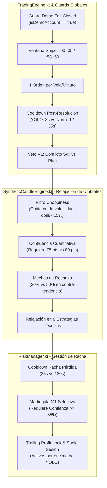

# R23B — AUDITORÍA TÉCNICA EXHAUSTIVA DE MODO YOLO EN CUENTA DEMO

**Fecha:** 2026-10-15  
**Autor:** AGY (Orquestador)  
**Proyecto:** TradeDraw (Rama `r10-night`, HEAD `438f458` / Base R23A `bd7ef4e`)  
**Dispositivo:** Xiaomi Redmi A1 (`220733SL`, Serial: `UGU8KFUKM7E6CE8D`)  
**Entorno de Seguridad:** Conexión USB Directa, Cuenta DEMO Estricta (`isDemoAccount == true`)  

---

## 1. RESUMEN EJECUTIVO Y ESTADO INICIAL

### 1.1 Cierre Formal de Fase R23A
La fase **R23A** (Modo Autónomo en DEMO) ha finalizado exitosamente con tres iteraciones aprobadas (`KEEP`):
1. **Iteración 1 (Commit `7a37032`):** Ajuste del umbral V2 para la familia sintética `IDX` ($10^{-11}$) y triple guard `isDemoAccount` fail-closed.
2. **Iteración 2 (Commit `bfd0416`):** Acoplamiento directo de stake de pantalla ($100.000\text{ COP}$) con `effectiveStake` en `RiskManager`, erradicando el desacoplamiento nominal de 1 USD.
3. **Iteración 3 (Commit `bd7ef4e`):** Corrección estricta de sintaxis JSON (RFC 8259) en `/status`, eliminando comentarios `//` dentro del template de string. 414 tests unitarios pasando al 100%.

**Métricas Finales de R23A en Hardware:**
- Saldo Inicial R23A: $38.054.735,36\text{ COP}$
- Saldo Final R23A: $38.320.737,28\text{ COP}$ ($\Delta +266.001,92\text{ COP}$ netos acumulados en DEMO).
- Versión desplegada en APK: `versionCode = 12`, `BUILD_ID = R23-AUTO-ITER3`.

### 1.2 Objetivo Científico de Fase R23B
Investigar de manera controlada y empírica el equilibrio entre **frecuencia de disparo y calidad técnica**, operando el submodo **YOLO** exclusivamente sobre **CUENTA DEMO** (`isDemoAccount == true`).
Buscamos cuantificar:
1. Qué filtros y guards relaja o elimina YOLO frente al modo autónomo normal (`CONSERVATIVE`).
2. Cuánto aumenta la tasa de disparo (trades por ventana de 20 minutos).
3. Cómo impacta esta mayor frecuencia en el Win Rate ($WR$) y en la dispersión de resultados.
4. Qué protecciones de capital o de microestructura son absolutamente indispensables y cuáles causan sobre-filtrado innecesario.
5. Qué mejoras o aprendizajes de YOLO pueden transferirse al modo normal para optimizarlo sin comprometer la seguridad.

---

## 2. AUDITORÍA DE CÓDIGO: ¿QUÉ HACE EXACTAMENTE EL MODO YOLO?

Se realizó una inspección exhaustiva de cada línea de código que referencia a `AutonomousSubMode.YOLO` a lo largo de todo el repositorio.



---

### 2.1 Módulo `SyntheticCandleEngine.kt` (Percepción y Acción del Precio)

Este módulo alberga la mayor parte de las diferenciaciones cuantitativas entre `CONSERVATIVE` y `YOLO`:

| Parámetro / Componente | Modo Normal (`CONSERVATIVE`) | Modo `YOLO` | Impacto en Operativa |
| :--- | :--- | :--- | :--- |
| **Detección Choppiness (`isChoppinessDetected`)** | Caída relativa de volatilidad (<40% del avg 20 velas) + Dojis con cuerpo <28% y CHOP >= 61.8 + 8 ticks alternantes. | **Elimina caída de volatilidad**. Solo veta si hay micro-rango estático (<0.05%) O dojis planos extremos (<15% cuerpo) con 10 ticks alternantes. | Reduce drásticamente los falsos vetos por consolidación leve. |
| **Supresión en `dispatchSniperOpportunity`** | Veta toda señal si hay chop y no hay contexto de reversión S/R. | **Desactivado por completo** (`if (!isYolo && isChoppy)`). | Permite buscar oportunidades incluso durante fases de transición. |
| **Filtro Anti-Contra-Tendencia (`isTrendDirectionAllowed`)** | Exige mecha de rechazo $\ge 50\%$ para operar contra tendencia. | Exige mecha de rechazo $\ge 30\%$. | Aumenta la permisividad para capturar giros tempranos. |
| **Falso Rompimiento (`MT_FALSE_BREAKOUT`)** | Exige mecha $\ge 45\%$. | Exige mecha $\ge 30\%$. | Facilita la detección de trampas institucionales. |
| **Puntaje de Confluencia Mínimo (`requiredScore`)** | $\ge 80$ puntos (Matriz Master Traders). | $\ge 75$ puntos. | Permite que setups de confluencia media califiquen para ejecución. |
| **Umbral de Mecha Plena en Confluencia** | $\ge 40\%$ otorga 25 pts; $\ge 28\%$ otorga 18 pts. | $\ge 32\%$ otorga 25 pts; $\ge 22\%$ otorga 18 pts. | Califica velas con menor sombra como setups de alta calidad. |

#### Relajación por Estrategias Específicas:
1. **`QUANT_CRYPTO` (Microestructura y TFI):**
   - Z-score 60 ticks: baja de $2.1$ a $1.9$.
   - Tick Flow Imbalance (TFI): umbral baja de $0.40$ a $0.30$.
   - Distancia máxima a soporte/resistencia: sube de $0.20$ a $0.25$.
   - Espacio libre a obstáculo en momentum: baja de $0.35$ a $0.28$.
2. **`MT_REJECTION` (Rechazo en S/R):**
   - Límite de zona extrema: se amplía de $0.24$ a $0.28$.
   - Mecha mínima requerida: se reduce de $45\%$ a $30\%$.
   - Cuerpo máximo tolerado: se relaja de $40\%$ a $54\%$.
3. **`MT_CONFIRM_BOUNCE` (Rebote Confirmado / 2da Vela de Giro):**
   - Se autoriza a operar incluso en presencia de choppiness (`isYolo || !isChoppy`).
   - Distancia límite a S/R: sube de $0.28$ a $0.34$.
   - Espacio libre requerido: baja de $0.38$ a $0.32$.
4. **`MT_3_VELAS_AGOT` (Agotamiento de 3 Velas en S/R):**
   - Ratio de decaimiento del cuerpo ($C_3 \le C_1 \times \text{ratio}$): se eleva de $0.45$ a $0.65$ (admite contracciones menos severas).
   - Proximidad a S/R: se relaja de $0.25$ a $0.28$.
5. **`MT_REVERSAL_EXTREMA` (Sobreextensión en Extremos):**
   - Umbrales RSI: se expanden de $22/78$ a $25/75$.
   - Ticks consecutivos necesarios: bajan de $4$ a $3$.
6. **`MT_CHOQUE_PULLBACK` (Breakout + Retest :00-:05s):**
   - Se autoriza en presencia de chop.
   - Cuerpo mínimo de ruptura: baja de $50\%$ a $42\%$.
   - Mecha opuesta máxima: sube de $20\%$ a $25\%$.
7. **`MT_PULLBACK_TREND` y `MT_MOMENTUM_TREND` (Tendencia y Continuación):**
   - Se autorizan en presencia de chop.
   - Espacio libre a barrera: baja de $0.30$ a $0.22$.
   - Ticks de confirmación de micro-giro: se reducen de $2$ a $1$.
   - Cuerpo de momentum direccional: baja de $40\%$ a $32\%$.
8. **`MT_RANGE_BOUNCE` (Rebotes Laterales):**
   - Ancho mínimo del canal relativo a ATR: baja de $1.5\times$ a $1.2\times$.
   - Mecha mínima: baja de $28\%$ a $22\%$.
   - Ticks de empuje requeridos: bajan de $2$ a $1$.

---

### 2.2 Módulo `TradingEngine.kt` (Orquestación del Motor)

| Componente | Comportamiento en Modo Normal | Comportamiento en Modo YOLO |
| :--- | :--- | :--- |
| **Espaciado Mínimo Post-Resolución (`minSpacingMs`)** | $12.000\text{ ms}$ (12s) en racha ganadora, o $35.000\text{ ms}$ (35s) si hay racha de pérdidas previa. | **$8.000\text{ ms}$ (8s) fijos**, permitiendo operar la vela inmediatamente siguiente sin quedar bloqueado por cooldowns de 35s. |
| **Veto 1 Orden por Vela (`lastExecutedCandleEpochMinute`)** | **ACTIVO**. Máximo 1 trade por minuto / vela de 60s. | **ACTIVO**. No se relaja. Evita sobreoperar múltiples veces en la misma vela. |
| **Ventana de Entrada Sniper (`isInEntryWindow`)** | **ACTIVO** (:00-:05s y :58-:59s). | **ACTIVO**. No se relaja. Exige entrar al nacimiento de la vela. |
| **Filtro Anti-Choppiness en `executeHeadlessTrade`** | Veta si detecta chop y el setup no es de rebote/mecha. | Veta únicamente si `isChoppinessDetected` (que en YOLO es mucho más estricto para declarar chop). |
| **Veto V1 (Conflicto S/R $\leftrightarrow$ Plan)** | **ACTIVO**. Veta si el plan contradice la zona S/R. | **ACTIVO**. No se relaja (coherencia arquitectónica). |
| **Veto V2 (Rango Relativo Mínimo por Activo)** | **ACTIVO** ($10^{-11}$ para `IDX`). | **ACTIVO**. No se relaja. |
| **Guard de Cuenta DEMO (`puedeOperarAutonomoEnDemo`)** | **ACTIVO**. Fail-closed si `!isDemoAccount`. | **ACTIVO Y OBLIGATORIO**. Si `isDemoAccount != true`, apaga a `DISABLED`. |

---

### 2.3 Módulo `RiskManager.kt` (Gestión de Riesgo y Racha)

1. **Cooldown de Pérdida (`yoloLossCooldownSeconds`):**
   - En `CONSERVATIVE`: Se aplican 180 segundos (3 minutos) tras 2 derrotas consecutivas (`EXTENDED_LOSS_COOLDOWN_SECONDS`) para evitar operar dentro de rangos viciosos.
   - En `YOLO`: Se aplica un cooldown breve de $35\text{ s}$ (`DEFAULT_YOLO_LOSS_COOLDOWN_SECONDS`, restringido a $30-45\text{ s}$). Esto permite tomar la orden de Martingala M1 en la siguiente vela sin perder el impulso del mercado.
2. **Martingala Selectiva M1:**
   - En YOLO, para ejecutar el nivel M1 de Martingala (tras 1 derrota), se exige un setup de alta confianza ($A+$, confianza normalizada $\ge 85\%$). Si la confianza es menor, se veta la orden para no arriesgar capital en setups mediocres.
3. **HALLAZGO CRÍTICO DE AUDITORÍA — Guards de Riesgo de Sesión:**
   - En `RiskManager.kt:471-487`, las comprobaciones de:
     * `sessionFloor` (`Stop Loss Sesion Alcanzado`, pérdida de 3% o 100.000 COP).
     * `Trailing Profit Lock` (ganancia asegurada si retrocede 40% del pico).
     * `stopLossStreak` (`Stop Loss alcanzado (3 derrotas)` en línea 506).
   - **Están situadas ANTES de la bifurcación `if (subMode == AutonomousSubMode.YOLO)`**.
   - *Consecuencia observada en vivo:* Si el saldo alcanza un pico y luego retrocede, el `Trailing Profit Lock` vetará operaciones incluso en YOLO. Esto explica por qué en `/status` actual se reporta:
     `ultimoVeto: "RISK_LIMIT Trailing Profit Lock: Ganancia asegurada (+392000 COP pico)"`.
   - Para el baseline de YOLO, este comportamiento debe observarse rigurosamente tal como está en el código base sin parches previos.

---

### 2.4 Módulo `AdaptiveLearningEngine.kt` (Autoaprendizaje)

- **Filtros Anti-Patrones y Sesgos:**
  El motor de autoaprendizaje declara explícitamente en la línea 186:
  > *"En modo YOLO la operativa es continua (no se apaga por límites de sesión), pero DEBE aplicar el 100% de los filtros de prudencia, vetos de racha y anti-patrones."*
  Por tanto, bloqueos por rachas de reversión/continuación (`ADAPTIVE_BLOCK`) siguen operando al 100% en YOLO.

---

### 2.5 Módulo `AutoTradeAccessibilityService.kt` (Capa de Despacho Físico)

- Las tres puertas de clic:
  1. `performClickRoot` (Línea 166)
  2. `performClickGesture` (Línea 268)
  3. `performClick` (Línea 488)
- Todas verifican `puedeDespacharTap(isDemoAccount)`. Si `isDemoAccount == false`, el tap es rechazado inmediatamente sin enviar eventos a la pantalla.

---

## 3. COMPARATIVA SINTÉTICA: GUARDS CONGELADOS VS RELAJADOS

```text
+-------------------------------------------------------------+-----------------------------+
| GUARD O REGLA DE SEGURIDAD                                  | ESTADO EN MODO YOLO         |
+-------------------------------------------------------------+-----------------------------+
| 1. Cuenta DEMO Estricta (isDemoAccount == true)             | INMUTABLE / FAIL-CLOSED     |
| 2. Máximo 1 trade por vela de 60s (lastExecutedCandle)      | INMUTABLE (Activo)          |
| 3. Ventana de entrada :00-:05s y :58-:59s (isInEntryWindow) | INMUTABLE (Activo)          |
| 4. Veto V1: Conflicto S/R <-> Plan de Acción                | INMUTABLE (Activo)          |
| 5. Veto V2: Rango Relativo Mínimo por Activo (1e-11 en IDX) | INMUTABLE (Activo)          |
| 6. Anti-patrones de Autoaprendizaje (ADAPTIVE_BLOCK)        | INMUTABLE (Activo)          |
| 7. Cooldown Post-Resolución                                 | RELAJADO (8s vs 12-35s)     |
| 8. Cooldown tras Pérdida Consecutiva                        | RELAJADO (35s vs 180s)      |
| 9. Filtro Choppiness por Caída de Volatilidad               | ELIMINADO en YOLO           |
| 10. Supresión por Choppiness sin S/R                        | ELIMINADO en YOLO           |
| 11. Umbral Confluencia Master Traders                       | RELAJADO (75 pts vs 80 pts) |
| 12. Umbrales de Mecha de Rechazo Contra-Tendencia           | RELAJADO (30% vs 50%)       |
| 13. Umbrales Z-score y TFI (QUANT_CRYPTO)                   | RELAJADO (1.9 vs 2.1)       |
+-------------------------------------------------------------+-----------------------------+
```

---

## 4. PROTOCOLO DE BASELINE R23B

Para evaluar el impacto puro del modo YOLO sin contaminar el experimento con cambios de código simultáneos:
1. **Activación de Submodo:**
   Invocar `POST/GET http://127.0.0.1:8080/submode?name=YOLO` asegurando que el motor permanezca en `AUTONOMOUS`.
2. **Monitoreo Live (Ventana de 20 minutos):**
   OpenCode ejecutará `live_monitor_r23_autonomous.py` recolectando ~100-120 muestras para medir:
   - Número de señales generadas (`signalsGenerated`).
   - Taps y órdenes despachadas (`tapsDespachados`).
   - Distribución de vetos (`CHOP`, `COOLDOWN`, `RISK_LIMIT`, `CONFLUENCIA`).
   - Balance final y Win Rate en cuenta DEMO.
3. **Formulación de Hipótesis 1:**
   A partir de los hallazgos del baseline, se seleccionará una única modificación quirúrgica orientada a estabilizar o potenciar el modo continuo.

---
*Fin del documento de auditoría R23B-YOLO.*
